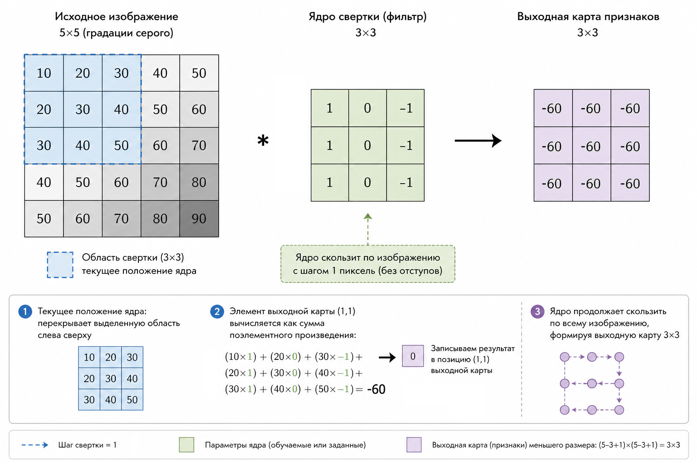
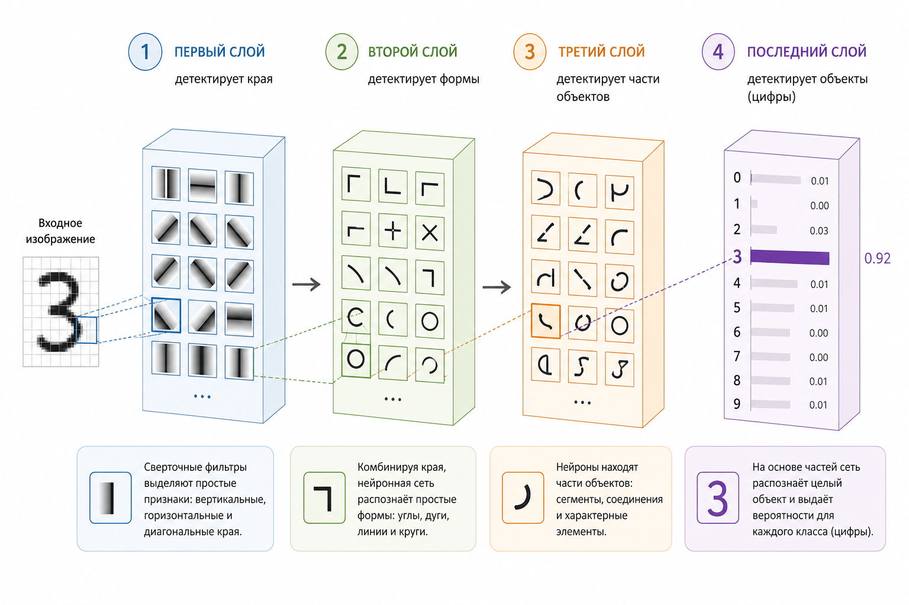
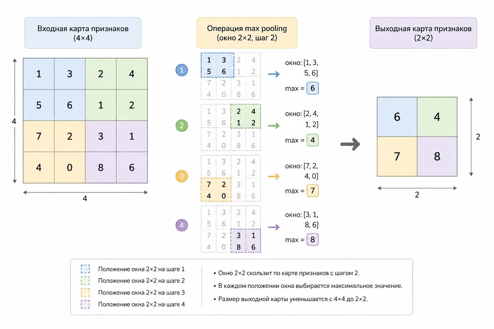

# 6.3 Свёрточные нейронные сети (CNN)

Если в предыдущих главах модели работали с таблицами и векторами, то теперь мы переходим к гораздо более "богатому" типу данных – изображениям. Интуитивно мы воспринимаем картинку как нечто цельное: лицо, цифру, объект. Но для модели это совсем не так.

Для модели изображение – это просто числа. И именно в этом месте начинается магия  свёрточных нейронных сетей.

### Почему изображение – это матрица

Любая картинка в компьютере – это сетка пикселей.

Если изображение представлено в градациях серого (например, изображения MNIST), то каждый пиксель – это одно число, обозначающее яркость:

* 0 – чёрный
* 255 – белый (или 1 после нормализации до диапазона 0–1)

В некоторых моделях значения пикселей нормализуют иначе, например до диапазона от -1 до 1.

Таким образом, картинка 28×28 превращается в матрицу:

$$
X \in \mathbb{R}^{28 \times 28}
$$

Цветные изображения чуть сложнее – там добавляется канал:

* RGB → 3 матрицы (красный, зелёный, синий)

$$
X \in \mathbb{R}^{H \times W \times 3}
$$

Важно не это.

Важно, что структура изображения сохраняется.

В отличие от обычного вектора (где порядок может быть условным), здесь:

* соседние пиксели связаны
* локальные паттерны имеют значение

И именно это используют CNN.

Например, небольшое изображение 3×3 можно представить в виде матрицы:

$$
X =
\begin{bmatrix}
0 & 0 & 255 \\
0 & 255 & 255 \\
255 & 255 & 255
\end{bmatrix}
$$

Каждое число соответствует одному пикселю. Чем больше значение, тем светлее пиксель: 0 означает чёрный цвет, а 255 – белый.

Это упрощённый пример. Реальные изображения обычно содержат гораздо больше пикселей.

### Главная идея CNN: смотреть не на всё, а на куски

Обычная нейросеть (полносвязная) "смотрит" на всё сразу:

$$
y = f(Wx + b)
$$

Но при непосредственной работе с пикселями у такого подхода есть недостатки:

* много обучаемых параметров
* пространственная структура изображения явно не учитывается
* модели приходится самостоятельно обучаться закономерностям между соседними пикселями


* слишком много параметров
* теряется локальная структура
* нет понимания "рядом / далеко"

CNN (convolutional neural network) делает иначе.

Она смотрит на маленькие области изображения – как будто "скользит" по нему маленьким окном.

Это окно называется фильтр (или ядро свёртки).

### Что такое свёртка (convolution)

Представим фильтр 3×3:

$$
K =
\begin{bmatrix}
1 & 0 & -1 \\
1 & 0 & -1 \\
1 & 0 & -1
\end{bmatrix}
$$

Он "накладывается" на изображение и считает взвешенную сумму.

Формально:

$$
y(i,j)=\sum_{m}\sum_{n} X(i+m,j+n)\cdot K(m,n)
$$

> Технически эта операция является cross-correlation, а не математической convolution, потому что ядро не переворачивается. Однако в deep learning такую операцию обычно называют convolution (свёрткой).

То есть:

* берём участок изображения
* умножаем поэлементно на фильтр
* складываем

Получаем одно число.

И так – для каждой позиции.

Результат применения фильтра ко всему изображению называется картой признаков (feature map).

Каждое число в этой карте показывает, насколько сильно фильтр реагирует на соответствующий участок изображения. Например, фильтр для поиска вертикальных границ будет давать сильный отклик там, где яркость заметно меняется слева направо.

Таким образом, вместо исходного изображения мы получаем новое представление, в котором выделены определённые признаки.

<figure><figcaption><p>Рис. 6.3-1. Скольжение свёрточного ядра по изображению</p></figcaption></figure>

### Что делает фильтр на практике

Разные фильтры находят разные паттерны. В этом примере мы задаём фильтр вручную, чтобы увидеть, как он работает. В настоящей CNN такие фильтры обычно обучаются автоматически.

#### 1. Вертикальные границы

$$
\begin{bmatrix}
1 & 0 & -1 \\
1 & 0 & -1 \\
1 & 0 & -1
\end{bmatrix}
$$

→ реагирует на переход “светлое → тёмное”

#### 2. Горизонтальные границы

$$
\begin{bmatrix}
1 & 1 & 1 \\
0 & 0 & 0 \\
-1 & -1 & -1
\end{bmatrix}
$$

#### 3. Размытие, резкость, текстуры

И вот ключевая мысль: Модель сама учится этим фильтрам.

Мы их не задаём.

### Локальные признаки – фундамент CNN

Почему это работает?

Потому что изображения состоят из локальных паттернов:

* линии
* углы
* текстуры

А дальше:

* линии → формы
* формы → части объектов
* части → целые объекты

Это и есть иерархия признаков.

<figure><figcaption><p>Рис. 6.3-2. Иерархия обучения в сверточных нейросетях</p></figcaption></figure>

### Почему это лучше, чем обычная нейросеть

Если взять изображение 28×28 и “расплющить”:

$$
784 \text{ входов}
$$

Полносвязный слой:

$$
784 \times 100 = 78\,400 \text{ параметров}
$$

или 78 500, если учитывать также 100 bias-параметров.

А теперь CNN:

* для одноканального изображения фильтр 3×3 содержит 9 весов
* для RGB-изображения - 3×3×3 = 27 весов
* применяется ко всей картинке

Это называется разделение весов (weight sharing).

Один и тот же фильтр:

* ищет один и тот же паттерн
* везде

На практике свёрточный слой обычно содержит несколько фильтров.

Например, один фильтр может реагировать на вертикальные границы, другой – на горизонтальные, а третий – на другие локальные паттерны. Это упрощённая иллюстрация: в реальной CNN фильтры обучаются на данных и не получают заранее заданных названий.

Каждый фильтр создаёт собственную карту признаков. Все эти карты вместе передаются следующим слоям сети, которые могут использовать их для выделения более сложных признаков.

### Страйд и паддинг (коротко)

Чтобы управлять размером выхода:

* stride – шаг сдвига фильтра
* padding – добавление рамки вокруг изображения

Без формального перегруза:

* stride > 1 → обычно уменьшает пространственный размер
* padding → добавляет рамку и позволяет управлять размером выхода; при подходящем padding можно сохранить исходный размер

### Пулинг (Pooling): сжатие информации

После свёртки часто делают pooling.

Самый популярный – max pooling:

* берём окно 2×2
* выбираем максимум

$$
y = \max(x_1, x_2, x_3, x_4)
$$

Зачем?

* уменьшаем пространственный размер
* уменьшаем количество вычислений
* сохраняем наиболее сильные активации
* иногда это также помогает контролировать переобучение

<figure><figcaption><p>Рис. 6.3-3. Операция максимального пулинга на карте объектов</p></figcaption></figure>

### Полная архитектура CNN (интуитивно)

Типичный pipeline:

1. Свёртка (Conv)
2. Активация (ReLU)
3. Пулинг
4. Повторить несколько раз
5. Flatten
6. Полносвязные слои
7. Softmax

У каждого этапа своя задача:

* **Свёртка (Conv)** – извлекает локальные признаки из изображения
* **ReLU** – добавляет нелинейность, позволяя сети изучать более сложные закономерности
* **Пулинг (Pooling)** – уменьшает пространственный размер карт признаков
* **Flatten** – преобразует карты признаков в один длинный вектор
* **Полносвязные слои** – используют извлечённые признаки для принятия решения
* **Softmax** – преобразует выходные значения в вероятности классов при многоклассовой классификации

Это один из вариантов архитектуры. В других CNN некоторые этапы могут отсутствовать или заменяться другими операциями.

### Минимальный пример на PHP (интуитивно)

PHP редко используется для самого обучения глубоких нейронных сетей в production, но отлично подходит для учебных реализаций и интеграции ML-моделей в веб-приложения.

#### Простая свёртка

```php
function convolve($image, $kernel) {
    $h = count($image);
    $w = count($image[0]);

    $kh = count($kernel);
    $kw = count($kernel[0]);

    $output = [];

    for ($i = 0; $i <= $h - $kh; $i++) {
        for ($j = 0; $j <= $w - $kw; $j++) {

            $sum = 0;

            for ($m = 0; $m < $kh; $m++) {
                for ($n = 0; $n < $kw; $n++) {
                    $sum += $image[$i + $m][$j + $n] * $kernel[$m][$n];
                }
            }

            $output[$i][$j] = $sum;
        }
    }

    return $output;
}
```

#### Пример фильтра (вертикальные границы)

```php
$kernel = [
    [1, 0, -1],
    [1, 0, -1],
    [1, 0, -1],
];
```

#### Пример изображения (упрощённо)

```php
$image = [
    [10, 10, 10, 0, 0],
    [10, 10, 10, 0, 0],
    [10, 10, 10, 0, 0],
    [10, 10, 10, 0, 0],
    [10, 10, 10, 0, 0],
];
```

После свёртки вы получите карту признаков, где "светятся" границы.

Результат:

```
Карта признаков:
0	30	30
0	30	30
0	30	30
```

В этом примере фильтр реагирует на переход от ярких пикселей к тёмным. Значения 30 показывают положительный отклик фильтра, а нули – отсутствие отклика на выбранный паттерн.

Важно понимать, что фильтр не распознаёт границу как человек. Он вычисляет взвешенную сумму значений пикселей, а интерпретация результата зависит от самого фильтра.

### Почему CNN "понимает" картинки

Важно быть точным.

CNN ничего не "понимает" в человеческом смысле.

Она:

* ищет статистические закономерности
* строит иерархию признаков
* сопоставляет паттерны с классами

Но за счёт:

* локальности
* разделения весов
* глубины

она делает это невероятно эффективно.

### Связь с предыдущими главами

Если упростить:

* логистическая регрессия → линейная граница
* kNN → похожие объекты
* Naive Bayes → вероятности признаков
* CNN → учится извлекать сами признаки

И это по-настоящему следующий уровень.

### Выводы и следующие шаги

Свёрточные сети – это не просто ещё один алгоритм. Это принципиально другой способ смотреть на данные:

* изображение – это структура, а не просто набор чисел
* важны локальные зависимости
* признаки можно учить автоматически

И самое важное:

Модель перестаёт зависеть от ручного feature engineering.

В следующей главе мы сделаем шаг дальше и рассмотрим автокодировщики.


Чтобы самостоятельно протестировать этот код, воспользуйтесь [онлайн-демонстрацией](https://aiwithphp.org/books/ai-for-php-developers/examples/part-6/convolutional-neural-networks) для его запуска.

