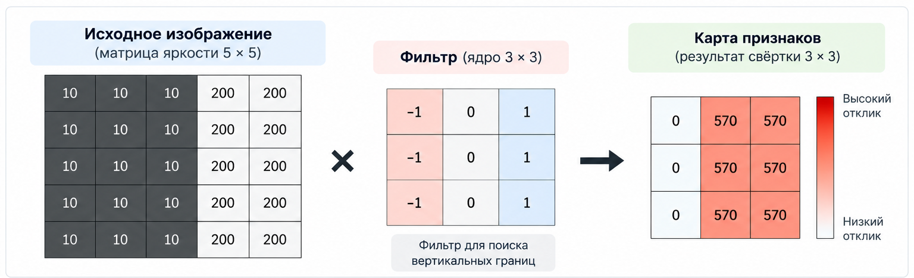
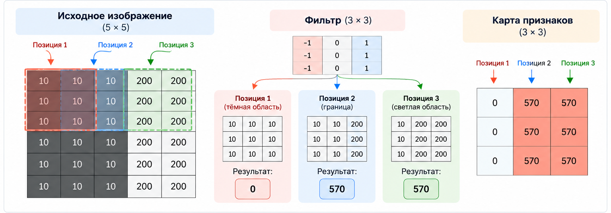

# Кейс 1. Свёртка на чистом PHP

## Кейс 1. Свёртка на чистом PHP

Реализуем операцию convolution вручную и посмотрим, как фильтр выделяет признаки на изображении.

### Цель кейса

В предыдущей главе мы познакомились со свёрточными нейронными сетями и рассмотрели, как они используют фильтры для обнаружения признаков на изображениях.

Теперь разберёмся, как работает одна из основных операций CNN – свёртка (convolution).

Для этого реализуем её самостоятельно на чистом PHP, без сторонних библиотек и готовых ML-алгоритмов.

В результате мы научимся:

* представлять небольшое изображение в виде двумерного массива чисел
* применять к изображению фильтр (kernel)
* вычислять значения результирующей матрицы вручную
* понимать, почему один фильтр выделяет вертикальные границы, а другой – горизонтальные
* видеть, как свёртка преобразует исходное изображение в карту признаков (feature map)

Главная цель: понять механику свёртки на уровне кода, чтобы в дальнейшем легче разбираться в работе свёрточных нейронных сетей.

### 2. Сценарий

Представим, что у нас есть небольшое чёрно-белое изображение. Для простоты будем считать, что оно состоит из пикселей, значения которых находятся в диапазоне от 0 до 255:

* `0` – чёрный пиксель;
* `255` – белый пиксель;
* промежуточные значения – оттенки серого.

Наша задача – найти на изображении вертикальные границы, то есть места, где яркость резко меняется слева направо.

Например, это может быть граница между тёмной стеной и светлым окном.

Для этого мы создадим фильтр размером `3 × 3` и будем последовательно перемещать его по изображению. В каждой позиции фильтр будет обрабатывать участок из девяти пикселей: умножать значения пикселей на соответствующие веса и складывать результаты.

Каждое такое вычисление даст одно число. Собрав все полученные значения, мы получим новую матрицу – карту признаков (feature map).

На схеме ниже показаны три основных элемента этого процесса:

* Исходное изображение – матрица, содержащая значения яркости пикселей
* Фильтр – небольшая матрица весов, с помощью которой мы ищем определённые признаки на изображении
* Карта признаков – результат применения фильтра к исходному изображению

В этом кейсе мы не будем обучать нейронную сеть. Мы зададим фильтр вручную, чтобы сначала понять саму операцию. Позже станет понятно, как CNN обучается подбирать веса фильтров самостоятельно.

<figure><figcaption><p>Рис. 6.3-4. Применение фильтра к изображению и получение карты признаков.</p></figcaption></figure>

### 3. Что такое свёртка

Свёртка – это операция, при которой небольшая матрица весов перемещается по входной матрице. В каждой позиции соответствующие элементы двух матриц перемножаются, после чего результаты складываются.

Матрица весов называется ядром свёртки (kernel), а результат применения ядра ко всем допустимым позициям входа — картой признаков (feature map).

Например, пусть у нас есть участок изображения:

$$
\begin{bmatrix} 10 & 20 & 30 \\ 40 & 50 & 60 \\ 70 & 80 & 90 \end{bmatrix}
$$

И фильтр:

$$
\begin{bmatrix} -1 & 0 & 1 \\ -1 & 0 & 1 \\ -1 & 0 & 1 \end{bmatrix}
$$

Умножим элементы, стоящие на одинаковых позициях, и сложим результаты:

$$
\begin{aligned} &10(-1)+20(0)+30(1)\\ +{}&40(-1)+50(0)+60(1)\\ +{}&70(-1)+80(0)+90(1) \end{aligned}
$$

Получаем:

$$
-10+30-40+60-70+90=60
$$

Таким образом, для этого участка изображения результат равен $$60$$.

Это значение становится одним элементом выходной карты признаков. Затем фильтр перемещается на следующую позицию, и вычисление повторяется.

Обрати внимание: в классической математике свёртка предполагает переворот ядра, а в большинстве реализаций CNN выполняется операция cross-correlation – ядро применяется без переворота. В этой главе мы реализуем именно такой вариант, который обычно называют свёрткой в контексте CNN.

### 4. Подготовим данные

Чтобы сосредоточиться на алгоритме, будем использовать не настоящий файл изображения, а небольшую матрицу чисел.

Это удобно по двум причинам:

1. Мы точно знаем значения каждого пикселя и можем проверить вычисления вручную.
2. Нам не понадобятся GD, Imagick или другие библиотеки для обработки изображений.

Создадим изображение размером `5 × 5`. Левая часть будет тёмной, а правая – светлой:

$$
I = \begin{bmatrix} 10 & 10 & 10 & 200 & 200 \\ 10 & 10 & 10 & 200 & 200 \\ 10 & 10 & 10 & 200 & 200 \\ 10 & 10 & 10 & 200 & 200 \\ 10 & 10 & 10 & 200 & 200 \end{bmatrix}
$$

Здесь значения $$10$$ обозначают тёмные пиксели, а $$200$$ – светлые.

Между третьим и четвёртым столбцами находится вертикальная граница. Именно её мы хотим обнаружить.

Теперь определим фильтр:

$$
K = \begin{bmatrix} -1 & 0 & 1 \\ -1 & 0 & 1 \\ -1 & 0 & 1 \end{bmatrix}
$$

Отрицательные веса слева и положительные справа позволяют фильтру реагировать на разницу яркости между левой и правой частями участка.

Если значения слева и справа одинаковые, результат будет близок к нулю. Если справа пиксели значительно светлее, результат будет положительным и большим по абсолютной величине.

### 5. Реализуем свёртку на PHP

Создадим файл `convolution.php`.

Реализация будет поддерживать произвольные двумерные входные матрицы и ядра. Для простоты будем использовать следующие настройки:

* шаг перемещения фильтра (`stride`) – $$1$$
* дополнение границ нулями (`padding`) – отсутствует
* ядро не переворачивается
* результат не ограничивается диапазоном $$0 \ –\ 255$$

Последний пункт важен: значения карты признаков — это не исходные пиксели, а результаты математических вычислений. Они могут быть отрицательными или превышать `255`.

#### Полный код

```php
/**
 * Apply a convolution-style filter to a 2D matrix.
 *
 * This implementation uses cross-correlation:
 * the kernel is not flipped.
 *
 * @param array<array<int|float>> $input
 * @param array<array<int|float>> $kernel
 * @return array<array<int|float>>
 */
function convolve(array $input, array $kernel): array
{
    $inputHeight = count($input);
    $inputWidth = count($input[0] ?? []);

    $kernelHeight = count($kernel);
    $kernelWidth = count($kernel[0] ?? []);

    if ($inputHeight === 0 || $inputWidth === 0) {
        throw new InvalidArgumentException('Input matrix must not be empty.');
    }

    if ($kernelHeight === 0 || $kernelWidth === 0) {
        throw new InvalidArgumentException('Kernel must not be empty.');
    }

    foreach ($input as $row) {
        if (count($row) !== $inputWidth) {
            throw new InvalidArgumentException('Input matrix must be rectangular.');
        }
    }

    foreach ($kernel as $row) {
        if (count($row) !== $kernelWidth) {
            throw new InvalidArgumentException('Kernel must be rectangular.');
        }
    }

    if ($kernelHeight > $inputHeight || $kernelWidth > $inputWidth) {
        throw new InvalidArgumentException('Kernel must fit inside the input matrix.');
    }

    $outputHeight = $inputHeight - $kernelHeight + 1;
    $outputWidth = $inputWidth - $kernelWidth + 1;

    $output = [];

    for ($y = 0; $y < $outputHeight; $y++) {
        $outputRow = [];

        for ($x = 0; $x < $outputWidth; $x++) {
            $sum = 0;

            for ($ky = 0; $ky < $kernelHeight; $ky++) {
                for ($kx = 0; $kx < $kernelWidth; $kx++) {
                    $pixel = $input[$y + $ky][$x + $kx];
                    $weight = $kernel[$ky][$kx];

                    $sum += $pixel * $weight;
                }
            }

            $outputRow[] = $sum;
        }

        $output[] = $outputRow;
    }

    return $output;
}

/**
 * Print a matrix in a readable format.
 */
function printMatrix(array $matrix): void
{
    foreach ($matrix as $row) {
        echo implode("\t", 
            array_map(static fn (int|float $value): string => (string) $value, $row)
        ) . "\n";
    }
}

$image = [
    [10, 10, 10, 200, 200],
    [10, 10, 10, 200, 200],
    [10, 10, 10, 200, 200],
    [10, 10, 10, 200, 200],
    [10, 10, 10, 200, 200],
];

$verticalEdgeKernel = [
    [-1, 0, 1],
    [-1, 0, 1],
    [-1, 0, 1],
];

echo "Input image:\n";
printMatrix($image);
echo "\n";

echo "Vertical edge kernel:\n";
printMatrix($verticalEdgeKernel);
echo "\n";

echo "Feature map:\n";
$featureMap = convolve($image, $verticalEdgeKernel);
printMatrix($featureMap);
```

#### Как работает код

Разберём основные части функции `convolve()`.

1\. Вычисляем размер выходной матрицы

Поскольку фильтр перемещается по изображению без дополнения границ, размер результата определяется формулами:

$$
W_{\text{out}} = W_{\text{in}} - W_K + 1
$$

В нашем случае входная матрица имеет размер `5 × 5`, а ядро – `3 × 3`.

Поэтому:

$$
W_{\text{out}} = 5 - 3 + 1 = 3
$$

Результат будет иметь размер `3 × 3`.

2\. Перемещаем фильтр по изображению

Внешние циклы `for` определяют позицию фильтра. Переменная `$y` отвечает за строку, а `$x` — за столбец.

На каждой позиции фильтр покрывает участок размером `3 × 3`.

<figure><figcaption><p>Рис. 6.3-5. Перемещение фильтра по изображению с шагом 1 и вычисление значений карты признаков.</p></figcaption></figure>


3\. Перемножаем соответствующие элементы

Внутренние циклы перебирают элементы ядра:

```php
$pixel = $input[$y + $ky][$x + $kx];
$weight = $kernel[$ky][$kx];

$sum += $pixel * $weight;
```

Выбираем пиксель, берём соответствующий вес ядра, перемножаем их и прибавляем результат к общей сумме.

4\. Сохраняем результат

После обработки всего участка значение `$sum` становится одним элементом выходной матрицы:

```php
$outputRow[] = $sum;
```

Когда фильтр обработает все допустимые позиции, функция вернёт полную карту признаков.

### 6. Запустим программу

Выполним команду:

```
php convolution.php
```

Ожидаемый результат:

```
Input image:
10      10      10      200     200
10      10      10      200     200
10      10      10      200     200
10      10      10      200     200
10      10      10      200     200

Vertical edge kernel:
-1      0       1
-1      0       1
-1      0       1

Feature map:
0       570     570
0       570     570
0       570     570
```

Обратите внимание на результат: первая колонка карты признаков содержит нули, а две следующие– большие положительные значения.

Это не случайность. Именно такого поведения мы и ожидали от выбранного фильтра.

### 7. Разберём результат вручную

Чтобы понять, почему получилась именно такая карта признаков, рассмотрим три возможные позиции фильтра.

#### Позиция 1. Однородная тёмная область

Первый участок изображения:

$$
\begin{bmatrix} 10 & 10 & 10 \\ 10 & 10 & 10 \\ 10 & 10 & 10 \end{bmatrix}
$$

Применяем фильтр:

$$
\begin{bmatrix} -1 & 0 & 1 \\ -1 & 0 & 1 \\ -1 & 0 & 1 \end{bmatrix}
$$

Вычисление:

$$
\begin{aligned} S &= 10(-1)+10(0)+10(1)\\ & +10(-1)+10(0)+10(1)\\ & +10(-1)+10(0)+10(1)\\ &=0 \end{aligned}
$$

Все строки однородны, поэтому отрицательные и положительные слагаемые взаимно компенсируются.

Результат: $$0.$$ Фильтр не обнаруживает границу.

#### Позиция 2. Переход от тёмной области к светлой

Теперь фильтр захватывает участок:

$$
\begin{bmatrix} 10 & 10 & 200 \\ 10 & 10 & 200 \\ 10 & 10 & 200 \end{bmatrix}
$$

Для каждой строки получаем:

$$
10(-1)+10(0)+200(1)=190
$$

Таких строк три:

$$
S=190+190+190=570
$$

Результат: $$570$$. Фильтр обнаруживает значительное изменение яркости слева направо.

#### Позиция 3. Однородная светлая область

Последний участок:

$$
\begin{bmatrix} 10 & 200 & 200 \\ 10 & 200 & 200 \\ 10 & 200 & 200 \end{bmatrix}
$$

Для каждой строки:

$$
10(-1)+200(0)+200(1)=190
$$

Итог снова равен $$570$$.

Здесь есть важный нюанс: фильтр реагирует на разницу между левым и правым столбцами своего окна. Поэтому он может давать сильный отклик не только непосредственно на границе, но и на соседних позициях, где окно по-прежнему захватывает тёмные и светлые пиксели.

Это нормальное поведение выбранного ядра, а не ошибка реализации.

### 8. Эксперимент: изменим фильтр

Теперь проверим, как меняется результат, если применить другой фильтр к тому же изображению.

#### 8.1. Фильтр для горизонтальных границ

Вместо вертикального фильтра используем:

$$
K_H = \begin{bmatrix} -1 & -1 & -1 \\ 0 & 0 & 0 \\ 1 & 1 & 1 \end{bmatrix}
$$

Этот фильтр сравнивает нижнюю и верхнюю части участка.

Для однородной строки яркости по горизонтали результаты компенсируются между верхней и нижней строками. Поэтому на нашем изображении карта признаков будет состоять из нулей:

```php
$horizontalEdgeKernel = [
    [-1, -1, -1],
    [ 0,  0,  0],
    [ 1,  1,  1],
];

$featureMap = convolve($image, $horizontalEdgeKernel);
printMatrix($featureMap);
```

Результат:

```
0   0   0
0   0   0
0   0   0
```

Почему? Потому что наше изображение содержит вертикальную границу, но не содержит изменений яркости сверху вниз.

#### 8.2. Инвертируем направление границы

А теперь вернёмся к вертикальному фильтру и изменим знак его весов:

```php
$reverseVerticalKernel = [
    [ 1, 0, -1],
    [ 1, 0, -1],
    [ 1, 0, -1],
];

$featureMap = convolve($image, $reverseVerticalKernel);
printMatrix($featureMap);
```

Теперь карта признаков будет такой:

```
0    -570    -570
0    -570    -570
0    -570    -570
```

Модуль отклика остался прежним, но знак изменился.

Это показывает, что фильтр реагирует не просто на наличие границы, а на направление изменения яркости. В данном случае положительный результат соответствует переходу от тёмного к светлому слева направо, а отрицательный – противоположному направлению.

Если нас интересует наличие границы независимо от направления, можно анализировать абсолютные значения откликов или использовать дополнительные операции обработки.

### 9. Эксперимент: что изменится при увеличении контраста?

В исходном изображении яркость менялась от $$10$$ до $$200$$. Разница составляла:

$$
200-10=190
$$

Заменим светлые пиксели на $$100$$, оставив тёмные равными $$10$$.

```php
$image = [
    [10, 10, 10, 100, 100],
    [10, 10, 10, 100, 100],
    [10, 10, 10, 100, 100],
    [10, 10, 10, 100, 100],
    [10, 10, 10, 100, 100],
];

$featureMap = convolve($image, $verticalEdgeKernel);
printMatrix($featureMap);
```

Теперь разница яркости равна `90`, поэтому результат будет:

```
0    270    270
0    270    270
0    270    270
```

Отклик уменьшился с $$570$$ до $$270$$.

Это ожидаемо: фильтр вычисляет взвешенную сумму, поэтому при одинаковой структуре изображения более слабый контраст приводит к меньшим значениям отклика.

### 10. Что важно понимать об этой реализации

Мы реализовали основную механику свёртки, но намеренно оставили некоторые возможности за пределами этого кейса.

<table data-header-hidden><thead><tr><th width="343.71484375"></th><th></th></tr></thead><tbody><tr><td>Возможность</td><td>Что происходит в нашем примере</td></tr><tr><td><code>Stride</code></td><td>Равен <code>1</code>: фильтр перемещается на один пиксель</td></tr><tr><td><code>Padding</code></td><td>Не используется: фильтр не выходит за границы изображения</td></tr><tr><td>Размер ядра</td><td><code>3 × 3</code>, но функция допускает другие прямоугольные ядра</td></tr><tr><td>Обучение весов</td><td>Отсутствует: ядро задаётся вручную</td></tr><tr><td>Функция активации</td><td>Не применяется</td></tr><tr><td>Нормализация результата</td><td>Не выполняется</td></tr><tr><td>Обработка настоящих изображений</td><td>Пока используется только матрица яркости</td></tr></tbody></table>

Обрати внимание на последнее ограничение. Настоящее RGB-изображение содержит три канала: красный, зелёный и синий. В нашем примере мы работали только с одним каналом яркости.

Для обработки настоящего изображения потребуется сначала преобразовать его в матрицу яркости либо расширить алгоритм для работы с несколькими каналами.

Также в этой реализации используется cross-correlation, а не математическая свёртка с переворотом ядра. Именно такой вариант обычно используется в операциях, называемых convolution в библиотеках глубокого обучения.

### 11. Как это связано со свёрточными нейронными сетями?

На первый взгляд может показаться, что мы просто написали алгоритм обработки изображения. Но именно эта операция лежит в основе свёрточных слоёв CNN.

В нашей программе фильтр задан вручную:

```php
$verticalEdgeKernel = [
    [-1, 0, 1],
    [-1, 0, 1],
    [-1, 0, 1],
];
```

Мы заранее решили, какой признак хотим обнаружить, и подобрали подходящие веса.

В свёрточной нейронной сети всё устроено иначе:

1. На вход поступает изображение
2. Свёрточный слой применяет множество фильтров к входным данным
3. Каждый фильтр создаёт собственную карту признаков
4. В процессе обучения сеть корректирует веса фильтров, чтобы уменьшать ошибку предсказания
5. Несколько свёрточных слоёв могут последовательно формировать всё более сложные признаки

Например, первые слои могут научиться обнаруживать границы и простые текстуры. Более глубокие слои могут объединять их в более сложные структуры.

Важно понимать: вручную заданный фильтр демонстрирует механику операции, но сам по себе ещё не является обученной нейронной сетью.

### 12. Практическое задание

Попробуйте изменить программу самостоятельно.

#### Чек-лист экспериментов

Измените размер исходной матрицы на 7 × 7.  Попробуйте ядро размером 2 × 2. Создайте фильтр, который реагирует на горизонтальные границы. Инвертируйте знаки весов и сравните результаты. Измените контраст изображения и посмотрите, как меняется карта признаков. Добавьте параметр `stride`, чтобы фильтр перемещался через один или два пикселя.

Для дополнительного задания можно добавить `padding`: расширять изображение нулевыми пикселями по краям перед свёрткой. Это позволит сохранить исходный размер пространственных измерений при определённых сочетаниях размера ядра и дополнения.

### 13. Выводы

В этом кейсе мы реализовали операцию свёртки на чистом PHP и увидели, как небольшая матрица весов преобразует исходное изображение в карту признаков.

Главное, что нужно запомнить:

* Фильтр анализирует локальные участки изображения, а не всё изображение сразу
* Каждый результат получается умножением соответствующих элементов и сложением произведений
* Разные фильтры реагируют на разные структуры: вертикальные границы, горизонтальные границы и другие изменения
* Карта признаков показывает, насколько сильно фильтр реагирует в каждой позиции
* В CNN веса фильтров обычно не задаются вручную, а обучаются на данных

Свёртка – это способ извлекать локальные признаки из изображения с помощью небольшого набора обучаемых или заранее заданных весов.

Теперь, когда мы разобрались в самой операции, следующий логичный шаг – изучить, как несколько свёрточных фильтров работают одновременно, что такое stride и padding и почему после свёртки часто применяют функцию активации ReLU.

Именно из таких простых операций постепенно складывается полноценная свёрточная нейронная сеть.
