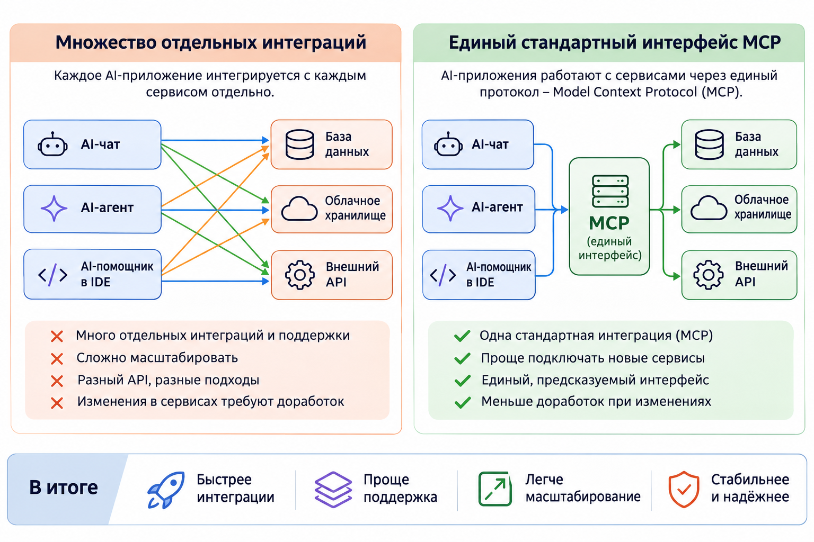
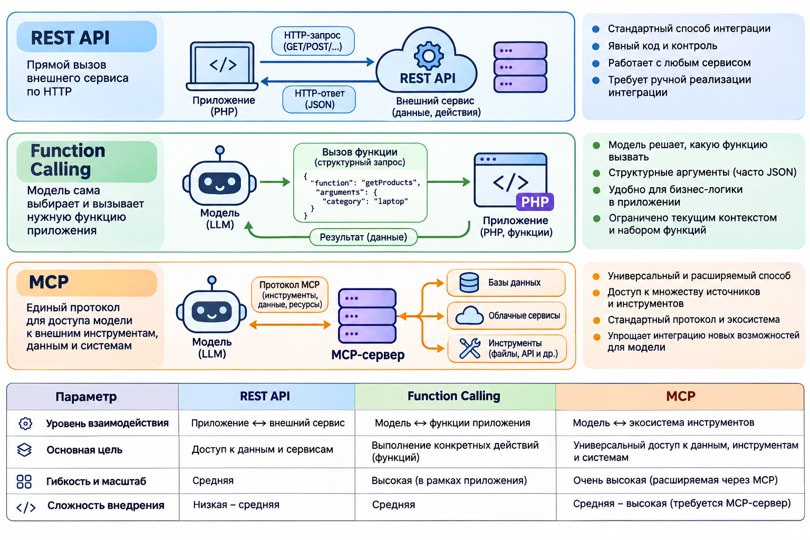
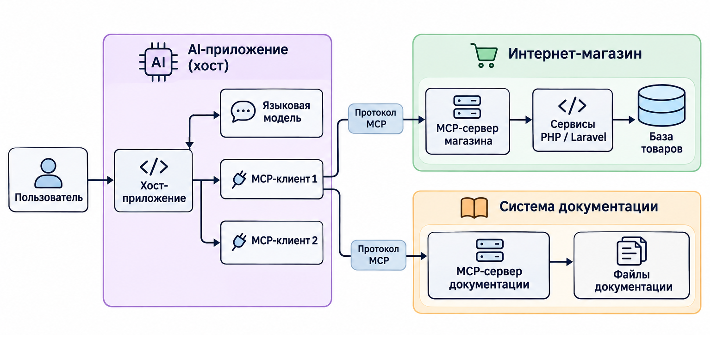
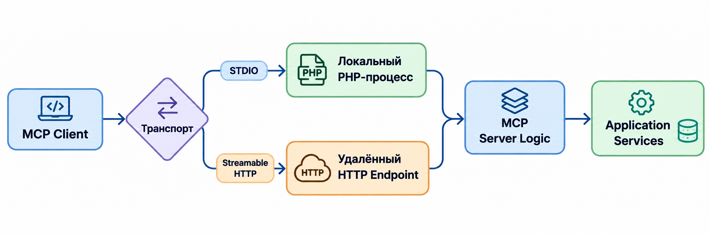
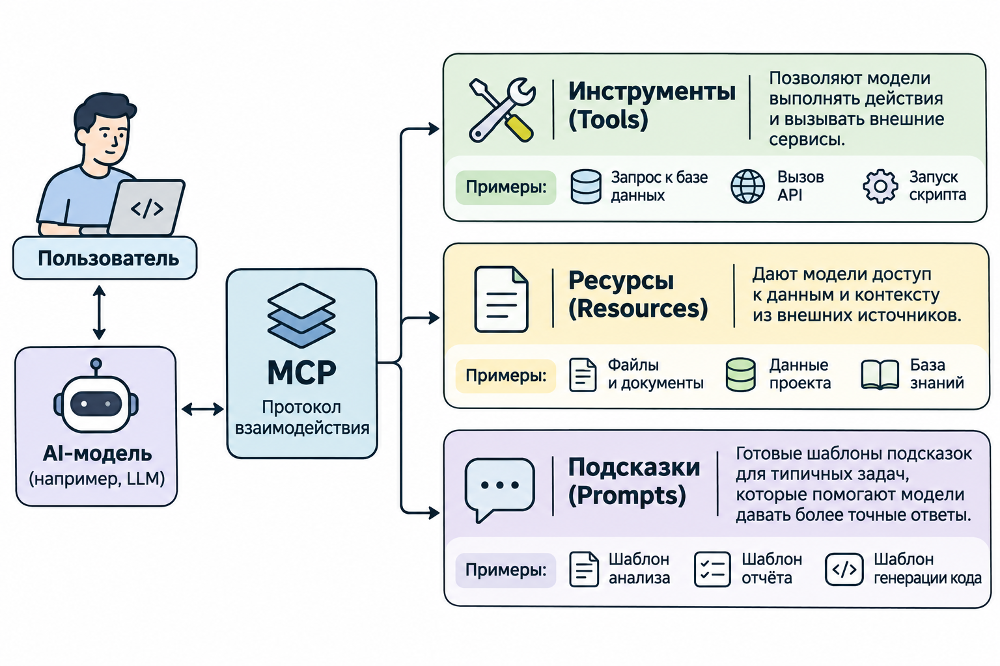
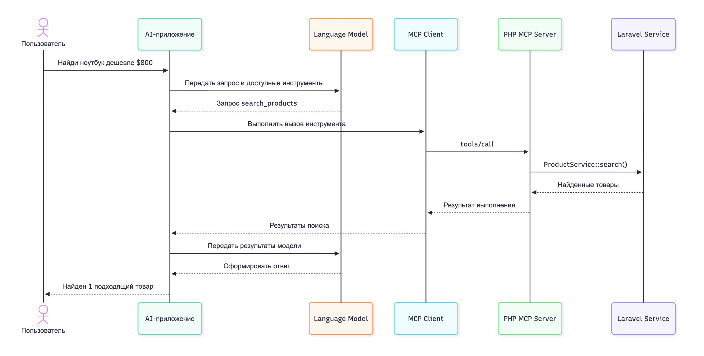

# 8.2.1 Понимание MCP и его архитектуры

### Введение

Мы уже рассмотрели, как AI-модели обрабатывают информацию, генерируют ответы и взаимодействуют с приложениями через API. Однако возможности AI становятся гораздо интереснее, когда модели могут использовать внешние инструменты, получать данные из других систем и выполнять реальные действия.

Представим, что у нас есть AI-ассистент, встроенный в интернет-магазин. Пользователь может задавать ему вопросы:

* Какие товары сейчас есть в наличии?
* Сколько заказов было оформлено за последнюю неделю?
* Где находится мой последний заказ?
* Найди товары дешевле $100.
* Создай новый заказ на выбранные товары.

Языковая модель умеет понимать эти запросы и формировать ответы. Но сама по себе она не имеет доступа к базе данных интернет-магазина, не знает текущих остатков товаров и не может создавать заказы.

Для этого AI-приложению необходимо взаимодействовать с внешними системами.

Традиционно разработчики решали эту задачу с помощью API, специальных интеграций и механизмов Function Calling. Однако по мере роста количества AI-приложений и внешних сервисов поддерживать такие интеграции становится всё сложнее.

**Model Context Protocol (MCP)** решает эту проблему, предлагая единый стандарт взаимодействия между AI-приложениями и внешними системами.

В этой главе мы разберём:

* Какую проблему решает MCP и почему он появился
* Чем MCP отличается от REST API и Function Calling
* Как устроена архитектура MCP и какую роль выполняют Host, Client и Server
* Как происходит обмен сообщениями между компонентами
* Что такое Tools, Resources и Prompts
* Как MCP может использоваться вместе с существующими PHP-приложениями

Наша цель – понять основные принципы протокола и научиться правильно представлять его место в архитектуре AI-приложений.

### Проблема интеграции AI с внешними системами

Начнём с практической ситуации.

Предположим, у нас есть интернет-магазин, написанный на PHP с использованием Laravel. Приложение содержит каталог товаров, систему управления заказами, информацию о клиентах и сервис управления складскими остатками.

Теперь мы хотим добавить AI-ассистента, который сможет отвечать на вопросы пользователей, используя данные нашего приложения.

Например, пользователь спрашивает:

"Найди ноутбуки дешевле $1000, которые сейчас есть в наличии".

Чтобы ответить на этот вопрос, AI-ассистенту необходимо:

1. Понять запрос пользователя
2. Получить список подходящих товаров
3. Проверить их стоимость
4. Проверить наличие на складе
5. Сформировать понятный ответ

Первые и последние действия связаны непосредственно с языковой моделью. Но получение актуальной информации требует обращения к нашему приложению.

При этом вся необходимая бизнес-логика уже существует в PHP-коде:

```php
$products = $productRepository->search(
    query: 'laptop',
    maxPrice: 1000
);

$availableProducts = $inventoryService->filterAvailable($products);

// Пример
// Array
// (
//    [0] => Array
//        (
//            [id] => 101
//            [name] => Laptop Pro 15
//            [price] => 899.00
//            [currency] => USD
//            [stock] => 12
//        ),
//    ...
//    [2] => Array
//        (
//            [id] => 105
//            [name] => Business Laptop 14
//            [price] => 950.00
//            [currency] => USD
//            [stock] => 8
//        )
// )
```

В результате мы получаем массив товаров, соответствующих поисковому запросу и ограничению по цене. Сервис управления складскими остатками дополнительно исключает товары, которых нет в наличии.

То есть, нам не нужно заново реализовывать поиск товаров или проверку остатков. Нужно только предоставить AI-приложению возможность использовать существующую функциональность.

Один из вариантов – создать специальную интеграцию между AI-приложением и нашим backend.

Например:

```
AI Application
      ↓
Custom Integration
      ↓
Laravel REST API
      ↓
Application Services
      ↓
Database
```

Для одного AI-приложения это достаточно простое решение.

Но представим, что мы хотим использовать те же возможности в нескольких местах:

* В AI-ассистенте на сайте
* В AI-powered IDE
* В desktop AI application
* В командной строке
* Во внутренней системе автоматизации

Теперь возникает необходимость поддерживать несколько интеграций с одним и тем же бекэндом.

Проблема становится ещё заметнее, если у нас появляется несколько внешних систем: GitHub, база данных, CRM, система мониторинга, документация и другие сервисы.

#### Почему количество интеграций становится проблемой

Рассмотрим упрощённую математическую модель.

Предположим, что каждое AI-приложение должно иметь доступ ко всем внешним сервисам и для каждого взаимодействия требуется отдельная интеграция.

Пусть у нас есть:

* (N) – количество AI-приложений
* (M) – количество внешних сервисов

Если каждое AI-приложение должно напрямую интегрироваться с каждым внешним сервисом, потенциальное количество интеграций составит:

$$
I_{\text{custom}} = N \times M
$$

Например, если у нас 4 AI-приложения и 6 внешних сервисов:

$$
I_{\text{custom}} = 4 \times 6 = 24
$$

Получается 24 потенциальные интеграции.

Это количество потенциальных логических интеграций в нашей упрощённой модели. В реальных системах не каждое AI-приложение обязательно взаимодействует со всеми сервисами, поэтому фактическое количество интеграций может быть меньше.

Теперь представим, что все приложения поддерживают общий протокол взаимодействия.

Каждому AI-приложению достаточно иметь MCP Client, а каждому внешнему сервису – MCP Server.

Количество необходимых точек интеграции в такой модели:

$$
I_{\text{MCP}} = N + M
$$

В нашем примере:

$$
I_{\text{MCP}} = 4 + 6 = 10
$$

Это значительно упрощает архитектуру.

Однако MCP не устраняет необходимость разработки интеграций полностью. Каждый MCP Server всё равно должен реализовать взаимодействие с соответствующей внешней системой, а каждый Host должен поддерживать MCP и необходимые возможности протокола.

Модель `N + M` показывает потенциальное уменьшение количества логических интеграций за счёт использования общего стандарта.

Важно понимать, что формулы показывают количество логических интеграций, а не точное количество программных компонентов или соединений. В реальных проектах могут существовать дополнительные ограничения, разные версии протокола, настройки доступа и особенности конкретных приложений.

Главная идея заключается в другом: вместо создания отдельной интеграции для каждой пары приложений мы используем общий стандарт.

<figure><figcaption><p>Рис. 8.2-1. Сравнение двух подходов: множество индивидуальных интеграций между AI-приложениями и сервисами и единый стандартизированный интерфейс MCP</p></figcaption></figure>

#### Как MCP решает эту проблему

Model Context Protocol предоставляет общий способ описания и использования внешних возможностей.

Вместо того чтобы создавать специальную интеграцию для каждого AI-клиента, мы можем реализовать MCP Server, который предоставляет функциональность нашего приложения.

Любой совместимый AI Host сможет подключиться к этому серверу через MCP Client.

Например, Laravel-приложение может предоставить следующие возможности:

* Поиск товаров
* Получение информации о заказах
* Проверка остатков
* Получение информации о клиента.

AI-приложение сможет обнаружить эти возможности и использовать их без знания внутренней реализации Laravel.

Оно не должно знать, какая база данных используется, какие ORM-модели существуют и какие сервисы выполняют бизнес-логику.

Ему достаточно понимать интерфейс, который предоставляет MCP Server.

Это и есть основная идея MCP: стандартизировать взаимодействие, сохраняя независимость между AI-приложениями и внешними системами.

### Что такое Model Context Protocol

**Model Context Protocol (MCP)** – это открытый протокол, который стандартизирует взаимодействие между AI-приложениями и внешними источниками данных, инструментами и сервисами.

Он определяет общий способ:

* Обнаружения доступных возможностей
* Получения контекстной информации
* Вызова внешних инструментов
* Передачи данных между приложениями
* Предоставления повторно используемых инструкций

MCP был представлен компанией Anthropic в ноябре 2024 года. Впоследствии он стал открытым стандартом, который поддерживается различными AI-платформами и инструментами разработки.

Для лучшего понимания можно провести аналогию с HTTP.

HTTP определяет общие правила взаимодействия между клиентами и серверами. Благодаря этому браузер может работать с большим количеством веб-сайтов, не требуя отдельной реализации протокола для каждого из них.

MCP использует похожую идею, но решает другую задачу.

HTTP стандартизирует сетевое взаимодействие приложений, а MCP стандартизирует предоставление контекста и внешних возможностей AI-приложениям.

Есть и другая интересная аналогия – [Language Server Protocol](https://en.wikipedia.org/wiki/Language_Server_Protocol) (LSP).

LSP стандартизирует взаимодействие редакторов кода с языковыми серверами. Благодаря этому один Language Server может использоваться в разных IDE.

MCP преследует похожую цель в мире AI: один MCP Server может предоставлять функциональность разным совместимым AI-приложениям.

#### MCP не является AI-моделью

Важно правильно понимать назначение протокола.

MCP:

* Не является языковой моделью
* Не обучает модели машинного обучения
* Не генерирует ответы самостоятельно
* Не заменяет OpenAI API или другие LLM API
* Не является базой данных или backend-фреймворком
* Не определяет, как именно AI-приложение должно использовать языковую модель

MCP отвечает за стандартизированный обмен контекстом и запросами между AI-приложением и внешними системами.

Языковая модель по-прежнему отвечает за понимание пользовательского запроса, анализ доступной информации и формирование ответа.

MCP предоставляет ей возможность использовать внешние данные и инструменты.

### MCP, REST API и Function Calling

Если вы уже работали с REST API или Function Calling, некоторые идеи MCP могут показаться знакомыми.

Все три подхода связаны с взаимодействием приложений и внешней функциональности, но решают разные задачи.

Разберём их подробнее.

#### MCP и REST API

REST – это архитектурный стиль, который широко используется при разработке веб-API.

REST API предоставляет набор endpoints, через которые другие приложения могут получать данные и выполнять операции.

Например, интернет-магазин может предоставлять следующие endpoints:

| Endpoint                | Назначение                   |
| ----------------------- | ---------------------------- |
| `GET /api/products`     | Получить список товаров      |
| `GET /api/products/123` | Получить конкретный товар    |
| `GET /api/orders/123`   | Получить информацию о заказе |
| `POST /api/orders`      | Создать новый заказ          |

PHP-приложение может обращаться к такому API с помощью HTTP-клиента:

```php
$client = new \GuzzleHttp\Client([
    'base_uri' => 'https://api.example.com',
]);

$response = $client->get('/api/products', [
    'query' => [
        'available' => true,
        'max_price' => 100,
    ],
]);

$products = json_decode($response->getBody()->getContents(), true);

// Пример
// [
//     {
//         "id": 101,
//         "name": "Wireless Mouse",
//         "price": 29.99,
//         "available": true,
//         "category": "Accessories"
//     },
//     ...
//     {
//         "id": 103,
//         "name": "USB-C Hub",
//         "price": 59.00,
//         "available": true,
//         "category": "Electronics"
//     }
// ]
```

REST API предоставляет механизм получения данных и выполнения операций. Однако он сам по себе не определяет, как AI-приложение должно обнаруживать доступные операции, понимать их назначение и использовать их в контексте диалога.

Для этого разработчику приходится создавать дополнительный слой интеграции.

MCP решает эту задачу.

Например, MCP Server может предоставить инструмент `search_products` с описанием его назначения и схемой входных параметров.

AI-приложение сможет обнаружить этот инструмент и понять, как его использовать.

При этом внутри MCP Server вполне может выполняться обычный HTTP-запрос к существующему REST API.

Поэтому MCP и REST API не конкурируют друг с другом. Они могут использоваться совместно.

#### MCP и Function Calling

Function Calling – это механизм, позволяющий языковой модели запросить выполнение внешней функции.

Предположим, мы предоставляем модели описание функции поиска товаров:

```php
{
    "name": "search_products",
    "description": "Search products in the catalog",
    "parameters": {
        "type": "object",
        "properties": {
            "query": {
                "type": "string",
                "description": "Product search query"
            },
            "max_price": {
                "type": "number"
            }
        },
        "required": ["query"]
    }
}
```

Пользователь спрашивает:

> "Найди ноутбук дешевле $1000".

Модель может определить, что для выполнения запроса необходимо вызвать `search_products`, и вернуть структурированный вызов:

```json
{
    "name": "search_products",
    "arguments": {
        "query": "laptop",
        "max_price": 1000
    }
}
```

Приложение получает этот вызов, выполняет соответствующую PHP-функцию и передаёт результат обратно модели.

Таким образом, Function Calling позволяет модели запрашивать выполнение внешних операций, используя структурированные аргументы.

Но здесь есть важное отличие.

Function Calling сам по себе не определяет универсальный способ подключения AI-приложений к внешним сервисам.

Разработчик должен предоставить описание функций, реализовать их выполнение и организовать интеграцию с конкретным AI API.

Если мы захотим использовать ту же функциональность в другом AI-приложении, возможно, придётся повторить часть этой работы.

MCP предлагает общий протокол, через который внешние возможности могут обнаруживаться и использоваться разными совместимыми AI-клиентами.

При этом MCP и Function Calling отлично работают вместе.

Например, MCP Client может получить список инструментов от MCP Server, преобразовать их описания в формат Function Calling конкретной модели, а затем выполнить выбранный инструмент через MCP.

Конкретная реализация такого взаимодействия зависит от AI-платформы и используемой модели. MCP Client или Host может адаптировать описания MCP Tools к формату tool calling, поддерживаемому конкретным AI API.

Таким образом, MCP отвечает за стандартизированную интеграцию, а Function Calling может использоваться как механизм выбора и вызова функций со стороны языковой модели.

#### Сравнение технологий

| Возможность                                                | REST API                                                                           | Function Calling                         | MCP               |
| ---------------------------------------------------------- | ---------------------------------------------------------------------------------- | ---------------------------------------- | ----------------- |
| Взаимодействие приложений                                  | Да                                                                                 | Через приложение                         | Да                |
| Вызов функций                                              | Через endpoints                                                                    | Да                                       | Tools             |
| Обнаружение инструментов                                   | Не является частью REST; может реализовываться через OpenAPI или другие механизмы. | Обычно приложение предоставляет описание | Стандартизировано |
| Доступ к контекстным данным                                | Через endpoints                                                                    | Через функции                            | Resources         |
| Повторно используемые шаблоны инструкций                   | Нет стандартного механизма                                                         | Обычно собственная реализация            | Prompts           |
| Стандартизированное взаимодействие AI-клиентов с сервисами | Нет                                                                                | Не является основной целью               | Да                |

<figure><figcaption><p>Рис. 8.2-2. Сравнение REST API, Function Calling и MCP: три разных уровня взаимодействия с внешней функциональностью</p></figcaption></figure>

Главное, что нужно запомнить: MCP не заменяет REST API и Function Calling. Он дополняет существующие технологии, стандартизируя интеграцию AI-приложений с внешними системами.

### Архитектура MCP

Теперь, когда мы понимаем, какую проблему решает MCP, рассмотрим его архитектуру.

MCP использует архитектуру Host – Client – Server.

В ней есть три основных компонента:

1. Host
2. Client
3. Server

У каждого компонента своя ответственность.

#### Host – AI-приложение

Host – это основное AI-приложение, с которым взаимодействует пользователь.

Именно Host управляет работой языковой модели, пользовательским интерфейсом и подключением к внешним MCP-серверам.

Примеры Host:

* Claude Desktop
* Claude Code
* AI-powered IDE
* Собственное AI-приложение
* Платформа для создания AI-агентов

Основные обязанности Host:

* Принимать запросы пользователя
* Взаимодействовать с языковой моделью
* Создавать и управлять MCP Clients
* Подключаться к MCP Servers
* Управлять доступом к внешним инструментам
* Объединять контекст из разных источников
* Применять политики безопасности и получать подтверждения пользователя, когда это необходимо

Представим, что разработчик работает с AI-ассистентом внутри IDE.

Он спрашивает:

> "Найди все открытые Pull Requests в нашем проекте и проверь, есть ли среди них изменения, связанные с безопасностью".

Host получает запрос и передаёт его языковой модели.

Модель определяет, что для выполнения задачи ей необходим доступ к GitHub.

Host использует соответствующий MCP Client, чтобы получить необходимую информацию.

Важно: Host не обязательно должен быть браузером или desktop-приложением. Это может быть любое AI-приложение, реализующее соответствующую архитектуру.

#### Client – компонент взаимодействия с сервером

MCP Client – это компонент внутри Host, который реализует протокол MCP и отвечает за взаимодействие с конкретным MCP Server.

Его основные обязанности:

* Устанавливать соединение с MCP Server
* Обнаруживать доступные возможности сервера
* Отправлять запросы
* Получать ответы
* Обрабатывать ошибки протокола
* Передавать результаты Host
* Обрабатывать уведомления и другие сообщения протокола

Один Host может управлять несколькими MCP Clients.

Каждый клиент (Client) взаимодействует с одним конкретным сервером (Server).

Например:

```
AI Host
  |
  +-- MCP Client 1 --> GitHub Server
  |
  +-- MCP Client 2 --> Database Server
  |
  +-- MCP Client 3 --> Filesystem Server
  |
  +-- MCP Client 4 --> Documentation Server
```

Каждый сервер предоставляет собственный набор возможностей.

При этом Client изолирует детали взаимодействия с конкретным сервером от остальной логики Host.

Это позволяет добавлять новые интеграции без необходимости переписывать всё AI-приложение.

#### Server – предоставление внешней функциональности

MCP Server – это компонент, который предоставляет внешние возможности и контекстную информацию AI-приложениям.

Сервер может быть:

* Локальным процессом
* Отдельным backend-приложением
* Удалённым HTTP-сервисом
* Компонентом существующей системы, предоставляющим интерфейс MCP

Например, PHP-приложение может предоставлять MCP Server, который открывает доступ к следующим возможностям:

* Поиск товаров
* Получение информации о заказах
* Проверка остатков на складе
* Получение информации о клиентах
* Чтение документации приложения

Внутри MCP Server может обращаться к:

* MySQL или PostgreSQL
* Laravel Services
* Существующим REST API
* Redis
* Внешним бизнес-системам

При этом MCP Server не обязан содержать языковую модель. Его задача – предоставить функциональность через стандартизированный интерфейс.

#### Как компоненты работают вместе

Посмотрим на общую архитектуру.

<figure><figcaption><p>Рис. 8.2-3. Как MCP компоненты работают вместе</p></figcaption></figure>


Рассмотрим последовательность взаимодействия.

1. Пользователь отправляет запрос AI-приложению.
2. Host передаёт запрос языковой модели.
3. Модель определяет, что ей необходима информация из внешней системы.
4. Host использует соответствующий MCP Client.
5. Client отправляет запрос MCP Server.
6. Server выполняет операцию или получает необходимые данные.
7. Результат возвращается Client.
8. Host предоставляет результат языковой модели.
9. Модель формирует ответ пользователю.

Обрати внимание: языковая модель не устанавливает прямое соединение с MCP Server.

Коммуникацией управляет Host через MCP Client.

Это важное архитектурное разделение. Оно позволяет контролировать доступ к внешним системам, изолировать интеграции и централизованно управлять взаимодействием с AI-моделью.

#### Один Host и несколько MCP Servers

Одно из главных преимуществ MCP – возможность подключать несколько независимых серверов к одному AI-приложению.

Представим, что мы хотим предоставить AI-ассистенту доступ к разным системам разработки:

<table><thead><tr><th width="271.28125">MCP Server</th><th>Возможности</th></tr></thead><tbody><tr><td>GitHub Server</td><td>Репозитории, Issues, Pull Requests</td></tr><tr><td>Database Server</td><td>Информация о структуре базы данных</td></tr><tr><td>Documentation Server</td><td>Чтение документации проекта</td></tr><tr><td>Monitoring Server</td><td>Получение метрик приложения</td></tr><tr><td>Filesystem Server</td><td>Работа с разрешёнными файлами</td></tr></tbody></table>

Каждый сервер отвечает за собственную область функциональности.

Если нам потребуется подключить ещё одну систему, мы можем добавить соответствующий MCP Server.

При этом существующие серверы и их внутренняя реализация могут остаться без изменений.

Именно такая модульность делает MCP полезным для сложных AI-приложений.

### Как происходит обмен сообщениями в MCP

Теперь рассмотрим, как компоненты MCP взаимодействуют технически.

MCP развивается, и его спецификация меняется между версиями протокола.

В предыдущих версиях MCP использовалась модель с предварительной инициализацией соединения через `initialize`, согласованием возможностей и управлением сессиями в некоторых транспортных сценариях.

В спецификации `2026-07-28` протокол перешёл к stateless-модели. В ней предварительная инициализация и протокольные сессии больше не являются обязательными, а необходимые метаданные передаются вместе с запросами.

В этой главе мы рассмотрим основные концепции MCP, общие для разных версий протокола, и отдельно отметим особенности новой модели там, где они влияют на техническую реализацию.

Для обмена сообщениями MCP использует [JSON-RPC 2.0](https://www.jsonrpc.org/specification).

JSON-RPC – это протокол удалённого вызова процедур (Remote Procedure Call), который использует JSON для передачи структурированных запросов и ответов.

Он определяет общий формат сообщений, понятный обеим сторонам.

#### Структура JSON-RPC сообщения

Упрощённый пример JSON-RPC запроса:

```json
{
    "jsonrpc": "2.0",
    "id": 1,
    "method": "tools/list",
    "params": {}
}
```

Рассмотрим основные поля:

* `jsonrpc` – версия JSON-RPC.
* `id` – идентификатор запроса.
* `method` – название вызываемого метода.
* `params` – параметры запроса.

Например, `tools/list` позволяет получить список доступных инструментов сервера.

Упрощённый пример ответа:

```json
{
    "jsonrpc": "2.0",
    "id": 1,
    "result": {
        "tools": [
            {
                "name": "search_products",
                "description": "Search products in the catalog"
            },
            {
                "name": "get_order",
                "description": "Retrieve order information"
            }
        ]
    }
}
```

Обрати внимание на `id`.

Он позволяет клиенту сопоставить ответ с исходным запросом. Это особенно важно, когда приложение отправляет несколько запросов и получает ответы в разное время.

В зависимости от версии MCP, информация о версии протокола, клиенте и поддерживаемых возможностях передаётся либо во время процедуры инициализации, либо в метаданных отдельных запросов.

В новой stateless-модели эти сведения передаются вместе с запросами. В примерах выше дополнительные метаданные опущены, чтобы сосредоточиться на основной структуре JSON-RPC-сообщений.

#### Вызов инструмента

Предположим, что клиент обнаружил инструмент `search_products`.

Теперь он может запросить его выполнение.

Упрощённый пример:

```json
{
    "jsonrpc": "2.0",
    "id": 2,
    "method": "tools/call",
    "params": {
        "name": "search_products",
        "arguments": {
            "query": "laptop",
            "max_price": 1000
        }
    }
}
```

Сервер получает запрос, проверяет аргументы и выполняет соответствующую операцию.

После выполнения возвращается результат:

```json
{
    "jsonrpc": "2.0",
    "id": 2,
    "result": {
        "content": [
            {
                "type": "text",
                "text": "Found 3 products matching your search."
            }
        ],
        "isError": false
    }
}
```

В реальных приложениях результат может содержать не только текст, но и другие поддерживаемые типы содержимого.

Также протокол предусматривает отдельный формат ошибок.

#### Основные типы сообщений

В MCP используются три основных типа сообщений.

**1. Requests**

Запросы предназначены для выполнения определённой операции и предполагают получение ответа.

Набор методов и порядок взаимодействия зависят от версии MCP.

Например:

* `initialize` – инициализация соединения и согласование возможностей в предыдущих версиях протокола.
* `server/discover` – обнаружение поддерживаемых версий протокола и возможностей сервера в новой stateless-модели.
* `tools/list` – получение списка инструментов.
* `tools/call` – вызов инструмента.
* `resources/list` – получение списка ресурсов.
* `resources/read` – чтение ресурса.
* `prompts/list` – получение списка шаблонов.
* `prompts/get` – получение выбранного шаблона.

**2. Responses**

Ответы содержат результат выполнения запроса или информацию об ошибке.

**3. Notifications**

Уведомления – это односторонние сообщения, которые не требуют ответа.

Например, сервер может сообщить клиенту об изменении доступных инструментов, Prompts или Resources.

В предыдущих версиях MCP уведомления об изменениях могли отправляться непосредственно клиенту. В новой stateless-модели механизм уведомлений основан на явных подписках: клиент использует `subscriptions/listen`, чтобы получать уведомления о событиях, на которые он подписался.

Это позволяет приложениям реагировать на изменения, не запрашивая постоянно одну и ту же информацию.

#### Транспортный уровень

JSON-RPC определяет структуру сообщений, но не определяет, каким способом они передаются между клиентом и сервером.

За это отвечает транспортный уровень (Transport Layer).

В актуальной спецификации MCP предусмотрены два стандартных транспорта:

* STDIO.
* Streamable HTTP.

**STDIO**

STDIO использует стандартные потоки ввода и вывода процессов:

* Standard Input (`stdin`).
* Standard Output (`stdout`).

Этот вариант применяется, когда Host запускает MCP Server как локальный процесс.

Например, AI-приложение может запустить PHP-процесс:

```
php mcp-server.php
```

После запуска клиент отправляет сообщения через стандартный ввод, а сервер возвращает ответы через стандартный вывод.

STDIO особенно удобен для локальных инструментов разработки, desktop-приложений и AI-ассистентов, работающих на компьютере разработчика.

Важная деталь реализации: стандартный вывод должен содержать только сообщения протокола. Отладочную информацию необходимо отправлять в `stderr`, иначе она может нарушить обмен сообщениями.

**Streamable HTTP**

Streamable HTTP позволяет взаимодействовать с удалённым MCP Server через HTTP.

Для этого используется один MCP endpoint.

Например:

```
https://example.com/mcp
```

Клиент отправляет MCP-сообщения через HTTP POST. Ответ может возвращаться в виде обычного JSON или потоковой передачи через Server-Sent Events (SSE).

Этот транспорт подходит для серверов, которые работают на удалённой инфраструктуре и должны обслуживать несколько клиентов.

Он также позволяет использовать стандартные механизмы HTTP-аутентификации и авторизации.

<figure><figcaption><p>Рис. 8.2-4. Два основных способа взаимодействия с MCP Server</p></figcaption></figure>

Важно понимать, что транспорт не меняет смысл сообщений MCP.

Например, вызов `tools/call` имеет одинаковое назначение независимо от того, используется STDIO или Streamable HTTP.

Меняется только способ передачи сообщений.

### Три основные возможности MCP

Теперь рассмотрим одну из важнейших частей протокола.

MCP Server может предоставлять три основных типа возможностей:

1. Tools.
2. Resources.
3. Prompts.

Они предназначены для разных задач и позволяют AI-приложениям не только получать информацию, но и взаимодействовать с внешними системами.

#### Tools – выполнение операций

Tools позволяют AI-приложению запрашивать выполнение операций во внешней системе.

По своей сути Tool похож на функцию или метод в обычном программировании.

Каждый Tool имеет:

* Уникальное имя.
* Описание назначения.
* Схему входных параметров.
* Реализацию на стороне MCP Server.

Например, интернет-магазин может предоставлять следующие инструменты:

<table><thead><tr><th width="271.78125">Tool</th><th>Назначение</th></tr></thead><tbody><tr><td><code>search_products</code></td><td>Поиск товаров</td></tr><tr><td><code>get_order_status</code></td><td>Получение статуса заказа</td></tr><tr><td><code>check_inventory</code></td><td>Проверка остатков</td></tr><tr><td><code>create_order</code></td><td>Создание заказа</td></tr><tr><td><code>cancel_order</code></td><td>Отмена заказа</td></tr></tbody></table>

Рассмотрим обычную PHP-функцию:

```php
function checkInventory(int $productId): int {
    // Здесь реализована логика:
    // получаем остаток товара из базы данных.
    return 25;
}
```

Сама по себе эта функция ещё не является MCP Tool.

Однако она может использоваться как реализация инструмента, который предоставляет MCP Server.

Сервер описывает этот инструмент через протокол и делает его доступным для совместимых AI-приложений.

**Обнаружение инструментов**

Одно из преимуществ MCP заключается в том, что клиенту необязательно заранее знать список всех доступных инструментов.

Он может запросить их у сервера с помощью `tools/list`.

Сервер возвращает список инструментов с описаниями и схемами входных параметров.

Например:

```json
{
    "name": "check_inventory",
    "description": "Check available stock for a product",
    "inputSchema": {
        "type": "object",
        "properties": {
            "product_id": {
                "type": "integer",
                "description": "The product identifier"
            }
        },
        "required": ["product_id"]
    }
}
```

Теперь AI-приложение знает:

* Как называется инструмент
* Для чего он предназначен
* Какие параметры принимает
* Какие параметры обязательны

Когда пользователь спрашивает:

> "Сколько единиц товара с ID 123 осталось на складе?"

Языковая модель может определить, что для выполнения запроса нужен `check_inventory`.

Host организует вызов инструмента через MCP Client, а сервер выполняет соответствующую операцию.

**Кто управляет вызовом Tools?**

В типичной модели MCP инструменты считаются model-controlled.

Это означает, что языковая модель может определять, когда тот или иной инструмент нужен для выполнения пользовательского запроса.

Однако это не означает, что модель может выполнять любые операции без ограничений.

Host может применять дополнительные правила:

* Требовать подтверждение пользователя
* Ограничивать доступные инструменты
* Проверять права пользователя
* Запрещать опасные операции
* Ограничивать количество вызовов

Например, поиск товаров может выполняться автоматически, а отмена заказа – только после подтверждения пользователя.

Это особенно важно для AI-приложений, которые могут изменять реальные бизнес-данные.

#### Resources – предоставление контекстной информации

Tools позволяют выполнять операции.

Resources решают другую задачу: предоставляют AI-приложению информацию, которую можно использовать в качестве контекста.

Resource представляет собой источник данных, доступный через MCP Server. Он не обязательно является статическим файлом или документом. Он может предоставлять динамически формируемые данные, например информацию о конкретном заказе, структуру базы данных, текущее состояние приложения или результаты запроса к внешней системе.

Примеры:

* Каталог товаров
* Схема базы данных
* Документация приложения
* Конфигурационные файлы
* Информация о клиентах
* Отчёты
* Данные о состоянии системы

Представим, что разработчик спрашивает AI-ассистента:

> "Объясни, как работает система обработки заказов в нашем приложении".

Для ответа модели может потребоваться архитектурная документация проекта.

MCP Server может предоставить эту документацию в виде Resource.

Например:

```
file:///docs/order-processing.md
```

Клиент может получить список доступных ресурсов и запросить содержимое конкретного ресурса.

Каждый Resource обычно содержит:

* URI – уникальный идентификатор ресурса
* Name – название
* Description – описание
* MIME Type – тип содержимого
* Content – данные ресурса при чтении

URI позволяет однозначно идентифицировать ресурс.

Например:

```
product://catalog/123
```

Такой URI может использоваться для идентификации информации о конкретном товаре.

Формат URI зависит от приложения и не обязательно должен соответствовать стандартному HTTP-адресу. Схема `product://` в данном примере является пользовательской схемой URI приложения и не определена самим MCP.

**Resources и Tools: в чём разница?**

Рассмотрим несколько примеров.

<table><thead><tr><th width="475.88671875">Задача</th><th>MCP-возможность</th></tr></thead><tbody><tr><td>Предоставить документацию о товарах</td><td>Resource</td></tr><tr><td>Предоставить схему базы данных</td><td>Resource</td></tr><tr><td>Прочитать документацию проекта</td><td>Resource</td></tr><tr><td>Найти товары по заданным параметрам</td><td>Tool</td></tr><tr><td>Рассчитать скидку</td><td>Tool</td></tr><tr><td>Создать новый заказ</td><td>Tool</td></tr></tbody></table>

Удобно запомнить следующее:

**Resources предоставляют контекст, а Tools выполняют операции.**

Resources обычно являются application-controlled: Host или пользователь определяет, какие ресурсы следует предоставить и использовать.

Tools обычно являются model-controlled: модель может выбирать подходящий инструмент в зависимости от запроса пользователя.

Это логическое разделение помогает правильно проектировать MCP Server.

#### Prompts – повторно используемые инструкции

Третья основная возможность MCP – Prompts.

Prompts позволяют предоставлять повторно используемые шаблоны инструкций для работы с языковыми моделями.

Представим, что в нашей компании AI используется для нескольких регулярных задач:

* Анализ PHP-кода
* Проверка SQL-запросов
* Генерация API-документации
* Анализ безопасности
* Обработка логов приложения

Для каждой задачи можно подготовить отдельный шаблон инструкций.

MCP Server может предоставлять такие шаблоны через протокол.

Например, сервер может содержать Prompt:

```
review_php_code
```

Он может принимать следующие аргументы:

```json
{
    "file_path": "app/Services/OrderService.php",
    "focus": "security and performance"
}
```

На основе этих параметров сервер формирует структурированный шаблон:

```
Review the following PHP code.

Focus on:
- Security vulnerabilities.
- Performance problems.
- Code readability.
- PHP best practices.

Pay special attention to: {focus}

File: {file_path}
```

AI-приложение может использовать этот шаблон для организации взаимодействия с языковой моделью.

Prompts обычно являются user-controlled.

Это означает, что пользователь может выбирать нужный шаблон через интерфейс Host.

Например, разработчик может выбрать шаблон `review_php_code`, после чего AI-ассистент выполнит анализ исходного кода по заданным инструкциям.

В отличие от Tools, Prompts не выполняют бизнес-операции.

В отличие от Resources, их основная задача – не предоставление данных, а организация взаимодействия с языковой моделью.

#### Сравнение Tools, Resources и Prompts

Сведём основные различия в одну таблицу.

<table><thead><tr><th width="135.91796875">Возможность</th><th width="212.96875">Основное назначение</th><th width="188.12109375">Типичный инициатор использования</th><th>Пример</th></tr></thead><tbody><tr><td>Tools</td><td>Выполнение операций</td><td>Model</td><td><code>create_order</code></td></tr><tr><td>Resources</td><td>Предоставление контекста</td><td>Application</td><td><code>product://catalog/123</code></td></tr><tr><td>Prompts</td><td>Повторно используемые инструкции</td><td>User</td><td><code>review_php_code</code></td></tr></tbody></table>

<figure><figcaption><p>Рис. 8.2-5. Три основные возможности MCP: Tools, Resources и Prompts</p></figcaption></figure>

Эти обозначения описывают типичную модель взаимодействия, а не обязательное ограничение протокола. Конкретный способ выбора и использования Tools, Resources и Prompts зависит от реализации Host.

Эти возможности не обязательно использовать независимо друг от друга.

Например, AI-ассистент интернет-магазина может:

1. Получить Resource с описанием каталога товаров
2. Использовать Tool для поиска товаров
3. Прочитать Resource с подробной информацией о выбранных товарах
4. Использовать Prompt для сравнения характеристик
5. Подготовить ответ пользователю

Таким образом, MCP позволяет объединять данные, инструменты и инструкции в единую систему взаимодействия с AI.

### Практический пример: подключение AI к PHP-приложению

Теперь объединим рассмотренные концепции на примере PHP-приложения.

Предположим, у нас есть Laravel-приложение интернет-магазина.

В нём уже существуют сервисы для поиска товаров и получения информации о заказах.

Мы хотим предоставить эти возможности AI-ассистенту через MCP.

Для начала определим, какие функции приложения следует открыть.

<table data-header-hidden><thead><tr><th width="515.4921875"></th><th></th></tr></thead><tbody><tr><td>Функциональность приложения</td><td>MCP-возможность</td></tr><tr><td>Поиск товаров</td><td>Tool</td></tr><tr><td>Получение статуса заказа</td><td>Tool</td></tr><tr><td>Проверка остатков</td><td>Tool</td></tr><tr><td>Документация каталога</td><td>Resource</td></tr><tr><td>Схема базы данных</td><td>Resource</td></tr><tr><td>Сравнение товаров</td><td>Prompt</td></tr></tbody></table>

Обрати внимание: нам не требуется переписывать существующую бизнес-логику.

Мы можем использовать уже реализованные сервисы, репозитории и модели.

Например, в Laravel у нас может быть следующий сервис:

```php
namespace App\Services;

class ProductService
{
    public function search(string $query, ?float $maxPrice = null): array {
        $products = [
            [
                'id' => 101,
                'name' => 'Laptop Pro',
                'price' => 899.00,
            ],
            [
                'id' => 102,
                'name' => 'Laptop Air',
                'price' => 749.00,
            ],
            [
                'id' => 103,
                'name' => 'Desktop Computer',
                'price' => 1200.00,
            ],
        ];

        return array_values(array_filter(
            $products,
            function (array $product) use ($query, $maxPrice): bool {
                $matchesQuery = stripos($product['name'], $query) !== false;
                $matchesPrice = $maxPrice === null || $product['price'] <= $maxPrice;

                return $matchesQuery && $matchesPrice;
            }
        ));
    }
}
```

Сервис знает, как искать товары.

При этом ему ничего не известно о MCP, AI-моделях или JSON-RPC.

Это правильное архитектурное разделение.

MCP Server может использовать этот сервис как реализацию инструмента `search_products`.

Упрощённое описание такого инструмента может выглядеть следующим образом:

```
{
    "name": "search_products",
    "description": "Search products in the store catalog",
    "inputSchema": {
        "type": "object",
        "properties": {
            "query": {
                "type": "string"
            },
            "max_price": {
                "type": "number"
            }
        },
        "required": ["query"]
    }
}
```

Когда пользователь спрашивает:

> "Найди ноутбук дешевле $800".

Происходит следующая последовательность:

<figure><figcaption><p>Рис. 8.2-6. Взаимодействие AI-ассистента с PHP-приложением через MCP</p></figcaption></figure>

Посмотрим, как распределяются обязанности:

* Language Model понимает запрос и выбирает подходящую операцию
* Host управляет взаимодействием
* MCP Client отвечает за коммуникацию по протоколу
* MCP Server предоставляет инструмент
* Laravel Service выполняет бизнес-логику

Это основное архитектурное преимущество MCP.

#### Пример PHP-функции, которая может стать MCP Tool

Чтобы лучше понять связь между обычным PHP-кодом и MCP Tool, рассмотрим упрощённый пример.

Следующая функция не является полноценным MCP Server. Она демонстрирует только бизнес-логику, которую сервер может предоставить через инструмент.

```php
function searchProducts(string $query, ?float $maxPrice = null): array {
    $products = [
        [
            'id' => 101,
            'name' => 'Laptop Pro',
            'price' => 899.00,
        ],
        [
            'id' => 102,
            'name' => 'Laptop Air',
            'price' => 749.00,
        ],
        [
            'id' => 103,
            'name' => 'Desktop Computer',
            'price' => 1200.00,
        ],
    ];

    return array_values(array_filter(
        $products,
        function (array $product) use ($query, $maxPrice): bool {
            $matchesQuery = stripos($product['name'], $query) !== false;
            $matchesPrice = $maxPrice === null || $product['price'] <= $maxPrice;

            return $matchesQuery && $matchesPrice;
        }
    ));
}

$result = searchProducts('Laptop', 800);

print_r($result);
```

Функция выполняет обычный поиск товаров.

MCP Server может описать её параметры, зарегистрировать инструмент и предоставить его AI-приложению.

Главная идея: бизнес-логика остаётся независимой от MCP.

Это позволяет использовать один и тот же сервис:

* В обычном PHP-приложении
* В REST API
* В фоновых задачах
* В MCP серверах
* В командных PHP-скриптах

В следующем подразделе мы перейдём к реализации и создадим полноценный MCP Server на PHP.

### Безопасность и границы доверия

Прежде чем перейти к разработке MCP сервера, важно рассмотреть ещё один аспект архитектуры – безопасность.

MCP упрощает подключение AI-приложений к внешним системам. Но это также означает, что AI-приложения могут получать доступ к конфиденциальным данным и выполнять операции, которые влияют на реальные бизнес-процессы.

Неправильно спроектированная интеграция может создать серьёзные проблемы безопасности.

Представим, что наш MCP Server предоставляет следующие инструменты:

```
search_products
get_customer
create_order
delete_customer
execute_sql
```

Все эти инструменты имеют разный уровень риска.

Поиск товаров обычно является операцией чтения.

Удаление клиента или выполнение произвольного SQL-запроса может привести к серьёзным последствиям.

Поэтому MCP нельзя рассматривать как самостоятельную границу безопасности.

Протокол стандартизирует взаимодействие, но не гарантирует безопасность операций.

#### Принцип минимальных привилегий

MCP Server должен предоставлять только те возможности, которые действительно необходимы AI-приложению.

Например:

* Ассистент для рекомендаций товаров может иметь только доступ к каталогу.
* Ассистент службы поддержки может получать информацию о заказах.
* Административный ассистент может иметь дополнительные полномочия, но только для авторизованных пользователей.

Сервер обязан проверять каждый входящий запрос.

Например, MCP Tool не должен доверять идентификатору заказа только потому, что его передала языковая модель.

Необходимо проверить, имеет ли текущий пользователь право получать информацию об этом заказе.

Упрощённый пример на PHP:

```php
function getOrder(int $orderId): array {
    $user = auth()->user();
    $order = Order::findOrFail($orderId);

    if ($order->user_id !== $user->id) {
        throw new RuntimeException('Access denied');
    }

    return $order->toArray();
}
```

В этом примере идентификатор пользователя определяется сервером через authentication context, а не передаётся как аргумент инструмента.

Это важно, поскольку аргументы MCP Tool могут формироваться языковой моделью и должны рассматриваться как недоверенные входные данные. Не следует использовать переданный моделью `userId` для определения прав доступа без дополнительной проверки.

В реальном Laravel-приложении для этого лучше использовать существующие механизмы авторизации, например Policies или Gates.

#### Основные правила безопасности

При разработке MCP Server следует учитывать несколько важных аспектов.

**Аутентификация**

При необходимости необходимо проверять личность пользователя или клиента, который обращается к серверу.

Для удалённых HTTP-соединений следует использовать подходящие механизмы аутентификации.

**Авторизация**

Не следует предполагать, что любое подключённое AI-приложение должно иметь доступ ко всем операциям.

Необходимо проверять права доступа на уровне конкретных инструментов и данных.

**Валидация входных параметров**

Все аргументы инструментов должны проходить проверку.

Даже если параметры сформировала AI-модель, они остаются внешними входными данными.

**Защита конфиденциальной информации**

Не следует предоставлять через Tools или Resources пароли, API-ключи, токены доступа и другие секретные данные.

**Подтверждение опасных операций**

Операции создания, изменения и удаления данных могут требовать дополнительного подтверждения пользователя.

**Недоверенный контент**

Информация, полученная из внешних систем, должна рассматриваться как данные, а не как доверенные инструкции для AI.

Например, описание товара в базе данных может содержать текст, пытающийся заставить AI-ассистента выполнить постороннюю операцию.

AI-приложение не должно автоматически воспринимать такое содержимое как инструкции.

Host также должен контролировать, какие MCP-серверы считаются доверенными и какие возможности разрешено предоставлять модели.

Главный принцип прост:

**MCP упрощает интеграцию, но ответственность за безопасность по-прежнему лежит на разработчиках приложения.**

### Итоги

Model Context Protocol предоставляет стандартизированный способ взаимодействия AI-приложений с внешними инструментами, сервисами и источниками данных.

При этом MCP продолжает развиваться, поэтому при разработке реальных приложений важно учитывать версию протокола, поддерживаемую конкретным Host и MCP Server.

Вместо того чтобы создавать отдельную интеграцию для каждого AI-приложения, разработчики могут предоставлять функциональность через MCP Servers и использовать её в разных совместимых AI-клиентах.

В этой главе мы рассмотрели основные концепции MCP:

* **MCP** – открытый протокол для стандартизированного взаимодействия AI-приложений с внешними системами
* **Host** – AI-приложение, которое управляет взаимодействием пользователя, языковой модели и MCP Clients
* **Client** – компонент, который реализует протокол MCP и взаимодействует с конкретным сервером
* **Server** – компонент, предоставляющий внешнюю функциональность и контекстную информацию
* **Tools** – инструменты для выполнения операций
* **Resources** – источники контекстной информации
* **Prompts** – повторно используемые шаблоны инструкций
* **JSON-RPC 2.0** – формат сообщений для взаимодействия компонентов
* **STDIO и Streamable HTTP** – способы передачи сообщений между клиентами и серверами

Самое важное – MCP не требует переписывать существующую бизнес-логику приложения.

Как PHP-разработчики, мы можем использовать уже существующие сервисы, репозитории и другие компоненты приложения, предоставляя выбранную функциональность через MCP Server.

Это позволяет разделить внутреннюю реализацию приложения и интерфейс взаимодействия с AI.

В следующем подразделе мы перейдём от теории к практике и создадим собственный MCP Server на PHP. Мы разберём структуру сервера, регистрацию инструментов, описание входных параметров и взаимодействие с MCP-клиентом.
