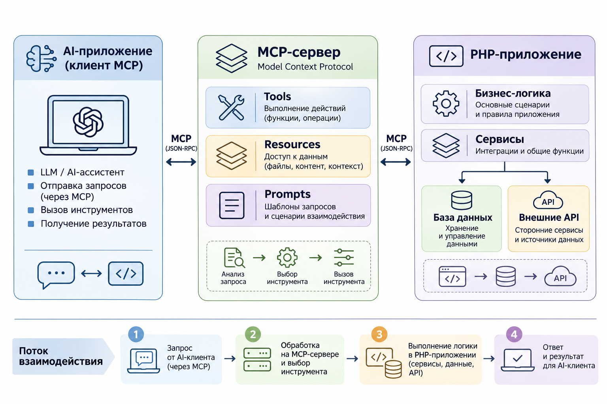
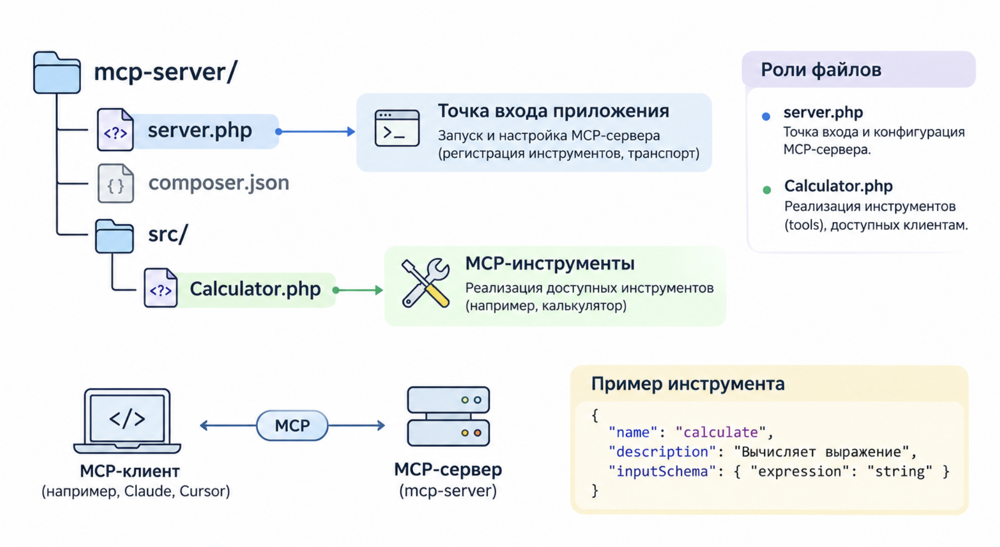
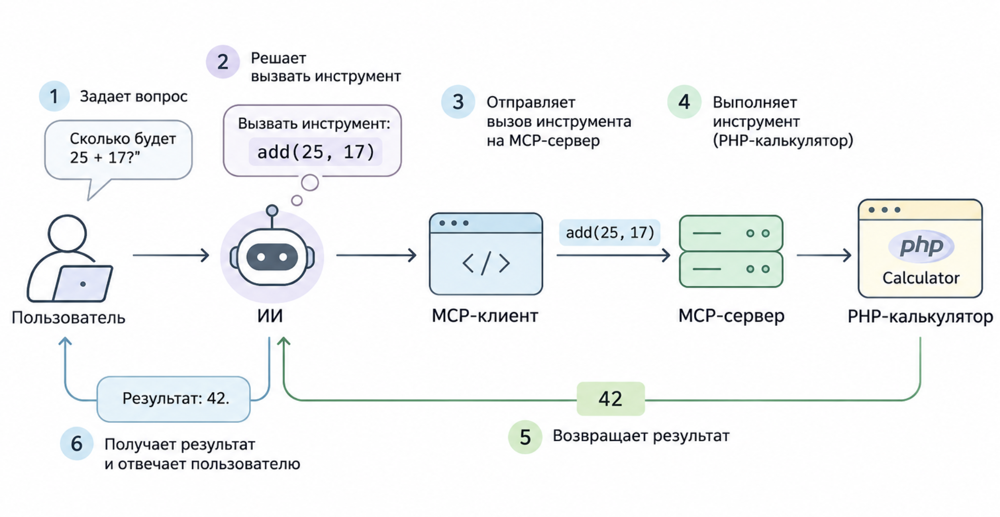
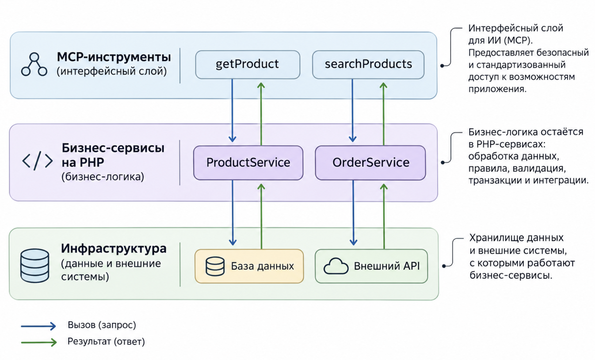

# 8.2.2 Создание MCP-сервера на PHP

В предыдущей главе мы рассмотрели архитектуру Model Context Protocol (MCP) и основные компоненты протокола. Теперь посмотрим, как создать собственный MCP-сервер на PHP.

MCP-сервер позволяет существующему PHP-приложению предоставлять свои возможности AI-приложениям. Вместо того чтобы создавать отдельный API для каждой AI-интеграции, мы можем описать доступные функции в стандартизированном формате MCP.

Например, PHP-приложение может предоставлять AI следующие возможности:

* искать товары
* проверять статус заказа
* получать информацию о пользователях
* выполнять аналитические запросы
* работать с внутренними сервисами

При этом MCP-сервер не обязан содержать бизнес-логику. Его задача – предоставить стандартизированный интерфейс, через который AI может взаимодействовать с существующим приложением.

В этой главе мы создадим простой MCP-сервер на PHP, познакомимся с официальным SDK, научимся регистрировать инструменты и рассмотрим способы запуска сервера.

### **Архитектура MCP-сервера**

MCP-сервер выступает посредником между AI-клиентом и приложением, предоставляющим данные или функциональность.

AI-клиент не должен знать, как устроена внутренняя система. Он знает только доступные инструменты, их описание и параметры.

Когда AI решает вызвать инструмент, MCP-клиент передаёт запрос серверу. Сервер выполняет соответствующую PHP-функцию и возвращает результат.

<figure><figcaption><p>Рис. 8.2-7. Архитектура MCP</p></figcaption></figure>

Основные компоненты этой архитектуры:

* **MCP Client** – AI-приложение, которое подключается к серверу и использует его возможности
* **MCP Server** – реализует протокол и предоставляет доступ к функциям приложения
* **Tools** – функции, которые AI может вызывать
* **Resources** – данные, которые AI может читать
* **Prompts** – шаблоны и инструкции, которые сервер может предоставлять клиенту
* **PHP Application** – существующая бизнес-логика, базы данных и внешние сервисы

Важно, что MCP-сервер не заменяет приложение. Он добавляет новый интерфейс взаимодействия с ним.

### **MCP SDK для PHP**

Для реализации MCP-сервера мы будем использовать официальный PHP SDK для Model Context Protocol.

SDK разработан в сотрудничестве с [PHP Foundation](https://thephp.foundation/) и [Symfony](https://symfony.com/) и предоставляет инструменты для создания MCP-серверов и клиентов.

Он поддерживает:

* Tools
* Resources
* Prompts
* STDIO
* Streamable HTTP
* автоматическое создание схем параметров
* интеграцию с PHP-классами и типами

Установка:

```bash
composer require mcp/sdk
```

Для автоматического поиска классов и регистрации их возможностей SDK использует Symfony Finder:

```bash
composer require symfony/finder
```

SDK берет на себя значительную часть технической работы:

* обработку MCP-сообщений
* регистрацию инструментов
* генерацию схем параметров
* сериализацию результатов
* обработку запросов
* работу с транспортом

В результате разработчик может сосредоточиться на реализации функций, которые действительно нужны AI.

Официальная документация:

* [MCP PHP SDK](https://php.sdk.modelcontextprotocol.io/?utm_source=chatgpt.com)
* [GitHub repository](https://github.com/modelcontextprotocol/php-sdk?utm_source=chatgpt.com)

### **Структура проекта**

Для небольшого MCP-сервера можно использовать простую структуру:

```
mcp-server/
├── composer.json
├── server.php
└── src/
    └── Calculator.php
```

В более крупном приложении структура может быть значительно сложнее. Например, MCP-сервер может находиться внутри существующего Laravel или Symfony приложения.

В нашем примере мы отделим MCP-обработчики от точки входа сервера.

<figure><figcaption><p>Рис. 8.2-8. Структура проекта</p></figcaption></figure>

### **Создание первого MCP-инструмента**

Начнем с простого примера – калькулятора.

AI сможет использовать функцию сложения двух чисел.

Создадим файл `src/Calculator.php`:

```php
namespace App;

use Mcp\Server\Capability\Attribute\McpTool;

class Calculator
{
    /**
     * Adds two numbers and returns the result.
     */
    #[McpTool]
    public function add(int $a, int $b): int
    {
        return $a + $b;
    }
}
```

Здесь мы используем PHP Attribute:

```
#[McpTool]
```

Этот атрибут сообщает SDK, что метод должен быть зарегистрирован как MCP Tool.

Метод `add()` принимает два параметра:

```php
int $a
int $b
```

SDK использует типы параметров для формирования схемы, которую MCP-клиент может передать AI.

Таким образом, нам не нужно вручную описывать JSON Schema для простого инструмента.

#### **Как AI видит этот инструмент**

На уровне MCP инструмент имеет имя, описание и параметры.

Упрощенно его описание может выглядеть следующим образом:

```json
{
  "name": "add",
  "description": "Adds two numbers and returns the result.",
  "inputSchema": {
    "type": "object",
    "properties": {
      "a": {
        "type": "integer"
      },
      "b": {
        "type": "integer"
      }
    },
    "required": ["a", "b"]
  }
}
```

Это описание позволяет AI понять:

* как называется инструмент;
* для чего он предназначен;
* какие параметры необходимы;
* какие типы данных ожидаются.

Когда AI решит использовать инструмент, он может сформировать вызов:

```json
{
  "name": "add",
  "arguments": {
    "a": 5,
    "b": 3
  }
}
```

MCP-клиент передаст этот вызов серверу, который выполнит PHP-метод.

Результат:

```
8
```

### **Запуск MCP-сервера**

Создадим файл `server.php`:

```php
require __DIR__ . '/vendor/autoload.php';

use Mcp\Server\Server;
use Mcp\Server\Transport\StdioTransport;

$server = Server::builder()
    ->setServerInfo('PHP Calculator', '1.0.0')
    ->setDiscovery(__DIR__, ['src'], excludeDirs: ['vendor'])
    ->build();

exit($server->run(new StdioTransport()));
```

Разберем основные части.

**`setServerInfo()`**

```php
->setServerInfo('PHP Calculator', '1.0.0')
```

Задает информацию о сервере:

* имя;
* версию.

Это помогает MCP-клиенту идентифицировать сервер.

**`setDiscovery()`**

```php
->setDiscovery(__DIR__, ['src'], excludeDirs: ['vendor'])
```

SDK сканирует указанный каталог и ищет классы с MCP-атрибутами.

В нашем случае он обнаружит:

```php
#[McpTool]
```

в классе `Calculator` и зарегистрирует метод `add()`.

**`run()`**

```php
->run(new StdioTransport())
```

Запускает сервер через STDIO-транспорт.

STDIO используется, когда AI-клиент запускает MCP-сервер как локальный процесс.

Например, клиент может выполнить:

```bash
php server.php
```

и взаимодействовать с сервером через стандартные потоки ввода и вывода.

### **Как работает вызов инструмента**

Рассмотрим последовательность взаимодействия.

Пользователь задает вопрос:

> What is 25 plus 17?

AI анализирует запрос и понимает, что может использовать инструмент `add`.

<figure><figcaption><p>Рис. 8.2-9. Рабочий процесс вызова инструментов</p></figcaption></figure>

Процесс состоит из следующих шагов:

1. Пользователь отправляет запрос AI.
2. AI определяет, что для ответа необходимо выполнить вычисление.
3. AI формирует вызов инструмента `add`.
4. MCP-клиент отправляет запрос MCP-серверу.
5. MCP-сервер вызывает PHP-метод.
6. PHP возвращает результат.
7. AI использует результат для формирования ответа.

При этом AI не выполняет PHP-код самостоятельно. Он лишь инициирует вызов инструмента.

### **Описание инструментов**

Описание инструмента играет важную роль.

AI использует описание для определения:

* когда следует использовать инструмент;
* какие данные необходимо передать;
* подходит ли инструмент для текущей задачи.

Например, можно создать инструмент:

```php
#[McpTool]
public function getWeather(string $city): array
{
    // Fetch weather data
}
```

Но если инструмент не имеет понятного описания, AI может не понимать, когда его использовать.

Лучше добавить описание:

```php
/**
 * Returns the current weather information for a city.
 */
#[McpTool]
public function getWeather(string $city): array
{
    // Fetch weather data
}
```

Описание должно быть конкретным.

Плохо:

> Gets information.

Лучше:

> Returns the current weather conditions and temperature for the specified city.

Хорошее описание помогает AI правильно выбирать инструменты.

### **MCP Tool как обычная PHP-функция**

С точки зрения разработчика MCP Tool может быть обычным методом PHP-класса.

Например:

```php
#[McpTool]
public function getUser(int $id): array
{
    return [
        'id' => $id,
        'name' => 'John',
        'email' => 'john@example.com',
    ];
}
```

Математически инструмент можно представить как функцию:

$$
f:X\rightarrow Y
$$

где:

* (X) – множество допустимых входных параметров;
* (Y) – множество возможных результатов.

Например:

$$
f(10)=\text{User}(10)
$$

AI выбирает входные параметры, а PHP-приложение выполняет функцию и возвращает результат.

Это важный принцип: **AI определяет, какую операцию выполнить, а PHP выполняет ее.**

### **Разделение MCP-слоя и бизнес-логики**

Не стоит размещать всю бизнес-логику непосредственно в MCP-методах.

Предпочтительнее использовать существующие сервисы приложения.

Например:

```
MCP Tool
    ↓
ProductService
    ↓
ProductRepository
    ↓
Database
```

MCP-обработчик отвечает за взаимодействие с протоколом.

Бизнес-сервис отвечает за бизнес-правила.

Репозиторий отвечает за доступ к данным.

<figure><figcaption><p>Рис. 8.2-10. Слой MCP и бизнес-логика</p></figcaption></figure>

Такой подход имеет несколько преимуществ:

* бизнес-логика не зависит от MCP;
* существующие API могут использовать те же сервисы;
* инструменты проще тестировать;
* можно добавлять новые AI-интерфейсы без изменения бизнес-логики.

### **Несколько инструментов на одном сервере**

MCP-сервер может предоставлять несколько инструментов.

Например:

```php
class Calculator
{
    #[McpTool]
    public function add(int $a, int $b): int
    {
        return $a + $b;
    }

    #[McpTool]
    public function subtract(int $a, int $b): int
    {
        return $a - $b;
    }

    #[McpTool]
    public function multiply(int $a, int $b): int
    {
        return $a * $b;
    }
}
```

AI может выбрать подходящий инструмент в зависимости от запроса.

Например:

> Calculate 10 multiplied by 5.

AI выберет `multiply()`.

> What is 10 minus 5?

AI выберет `subtract()`.

В реальных приложениях инструменты могут быть значительно сложнее, но принцип остается тем же.

### **Tools, Resources и Prompts**

MCP-сервер может предоставлять не только инструменты.

#### **Tools**

Tools – это операции, которые AI может вызвать.

Например:

```
searchProducts
createOrder
getUser
```

#### **Resources**

Resources предоставляют данные, которые клиент может читать.

Например:

```
config://application
docs://api
database://schema
```

#### **Prompts**

Prompts предоставляют готовые шаблоны взаимодействия.

Например:

```
analyze-customer
summarize-report
generate-product-description
```

\[IMAGE PLACEHOLDER 5 – Tools Resources Prompts]

**Промпт для изображения:**

> Clean minimalist educational infographic, flat vector style, white background, pastel blue, purple and green, dark navy outlines, landscape 3:2.
>
> Three equal visual columns:\
> Tools – a function icon, label "Выполняет действия", example "searchProducts()".\
> Resources – a document/database icon, label "Предоставляет данные", example "docs://api".\
> Prompts – a message/template icon, label "Готовые инструкции", example "analyze-report".
>
> Simple and visually balanced. Russian labels, no title.

Эти возможности решают разные задачи, поэтому не стоит превращать все в Tools.

Если AI должен выполнить действие, используйте Tool.

Если AI должен получить данные, может быть полезен Resource.

Если необходимо предоставить готовый сценарий взаимодействия, можно использовать Prompt.

### **Транспорт: STDIO**

STDIO – один из наиболее распространенных способов запуска локального MCP-сервера.

В этом случае MCP-клиент запускает сервер как отдельный процесс.

```
AI Application
      |
      | starts process
      ↓
PHP MCP Server
      |
      | stdin / stdout
      v
MCP Communication
```

\[IMAGE PLACEHOLDER 6 – STDIO transport]

**Промпт для изображения:**

> Clean minimalist educational infographic, flat vector style, white background, pastel colors, dark navy outlines, landscape 3:2.
>
> Show two separate processes:\
> Left: AI Application / MCP Client.\
> Right: PHP MCP Server.
>
> Connect them with two arrows:\
> stdin – requests from client to server.\
> stdout – responses from server to client.
>
> Show stderr as a separate logging channel.\
> Russian labels, no title.

STDIO хорошо подходит для:

* локальных AI-клиентов;
* IDE;
* desktop-приложений;
* локальных инструментов разработчика.

При работе через STDIO важно не выводить обычные сообщения в `stdout`, поскольку этот поток используется для MCP-коммуникации.

Для логов лучше использовать `stderr` или отдельный лог-файл.

### **Транспорт HTTP**

Для удаленного MCP-сервера используется HTTP-транспорт.

В этом случае сервер может работать как часть веб-приложения или отдельного PHP-сервиса.

```
AI Client
    |
    | HTTPS
    ↓
MCP Endpoint
    |
    ↓
PHP Application
    |
    ↓
Services / Database / APIs
```

\[IMAGE PLACEHOLDER 7 – HTTP transport]

**Промпт для изображения:**

> Clean minimalist educational infographic, flat vector style, white background, pastel blue, purple and green, dark navy outlines, landscape 3:2.
>
> Show architecture:\
> AI Client → HTTPS → MCP HTTP Endpoint → PHP Application → Business Services → Database.
>
> Include a shield icon near HTTPS and Authentication.\
> Use clear arrows.\
> Russian labels, no title.

HTTP-транспорт подходит для:

* удаленных серверов;
* облачных приложений;
* интеграции с несколькими клиентами;
* MCP-сервера, встроенного в существующее веб-приложение.

При использовании HTTP необходимо учитывать безопасность, аутентификацию, авторизацию и управление доступом.

### **Безопасность MCP-сервера**

MCP Tool предоставляет AI возможность взаимодействовать с приложением. Поэтому инструменты должны проектироваться с учетом безопасности.

Например, следующие инструменты имеют разный уровень риска:

```
getProduct
searchProducts
getOrderStatus
deleteUser
refundOrder
```

Первые три обычно предоставляют информацию.

Последние два могут изменять данные или выполнять финансовые операции.

Не следует автоматически предоставлять AI доступ ко всем функциям приложения.

#### **Принцип минимальных привилегий**

Инструмент должен иметь только те права, которые необходимы для его работы.

Например, инструмент поиска товаров не должен использовать database connection с правами изменения всей базы данных.

#### **Валидация**

Входные данные необходимо проверять.

Даже если параметры описаны через PHP-типы, бизнес-валидация остается необходимой.

Например:

* допустимые диапазоны значений;
* существование объекта;
* права пользователя;
* ограничения бизнес-правил.

#### **Подтверждение опасных операций**

Некоторые действия требуют дополнительного подтверждения.

Например:

```
AI:
I found order #12345.

Would you like me to cancel this order?
```

AI может подготовить операцию, но окончательное выполнение может требовать подтверждения пользователя.

\[IMAGE PLACEHOLDER 8 – Security]

**Промпт для изображения:**

> Clean minimalist educational infographic, flat vector style, white background, pastel blue, purple and green, dark navy outlines, landscape 3:2.
>
> Show a security concept for MCP tools.
>
> Left side: Read-only tools – searchProducts, getOrderStatus, getUser.\
> Right side: Write operations – createOrder, refundOrder, deleteUser.
>
> Read-only tools pass through a simple permission check.\
> Write operations pass through a stronger authorization gate and user confirmation.
>
> Show a shield and lock icons.\
> Russian labels, no title.

### **Интеграция MCP в существующее приложение**

Одно из главных преимуществ MCP заключается в возможности использовать существующую бизнес-логику.

Например, приложение уже может иметь:

```
$productService->searchProducts($query);
$orderService->getStatus($orderId);
$userService->getUser($userId);
```

MCP-сервер может просто предоставить эти операции AI.

При этом приложение может продолжать использовать те же сервисы через:

* Web UI;
* REST API;
* CLI;
* MCP.

\[IMAGE PLACEHOLDER 9 – Existing application integration]

**Промпт для изображения:**

> Clean minimalist educational infographic, flat vector style, white background, pastel colors, dark navy outlines, landscape 3:2.
>
> Center: Existing PHP Application with Business Services and Database.
>
> Four interfaces connected to the same business services:\
> Web UI,\
> REST API,\
> CLI,\
> MCP Server → AI Applications.
>
> Show that all interfaces reuse the same PHP business logic.\
> Russian labels, no title.

Это позволяет постепенно внедрять AI-функциональность, не переписывая приложение и не создавая отдельную бизнес-логику для каждого AI-интерфейса.

### **Тестирование MCP-сервера**

MCP-инструменты можно тестировать как обычные PHP-функции.

Например:

```php
$calculator = new Calculator();

$result = $calculator->add(5, 3);

assert($result === 8);
```

Однако этого недостаточно для полноценного тестирования MCP-сервера.

Также полезно проверять:

* регистрацию инструментов;
* правильность схем параметров;
* обработку некорректных аргументов;
* ошибки бизнес-логики;
* доступность сервера через выбранный транспорт.

Для интерактивного тестирования MCP-серверов можно использовать MCP Inspector.

Он позволяет подключиться к серверу, посмотреть список доступных инструментов и вручную выполнить их вызовы.

Пример запуска локального сервера через Inspector:

```bash
npx @modelcontextprotocol/inspector php server.php
```

### **Заключение**

Создание MCP-сервера на PHP не требует реализации протокола с нуля.

Официальный SDK предоставляет необходимые механизмы для регистрации инструментов, описания параметров, обработки запросов и организации транспорта.

Основные принципы создания MCP-сервера:

* MCP-сервер предоставляет интерфейс к существующему приложению.
* Tools описывают функции, которые AI может вызывать.
* PHP-типы и описания помогают формировать схемы инструментов.
* Бизнес-логика должна оставаться в сервисах приложения.
* STDIO подходит для локальных интеграций.
* HTTP подходит для удаленных серверов.
* Инструменты должны иметь четкие описания и ограничения.
* Безопасность должна быть частью архитектуры с самого начала.

В следующей главе мы применим эти знания на практике и создадим MCP-сервер, который предоставляет AI доступ к функциональности реального PHP-приложения.
